

# ⚙️ WormGear

### Worm and worm wheel for 3D printing, without supports

[Español](README.md) · **English**

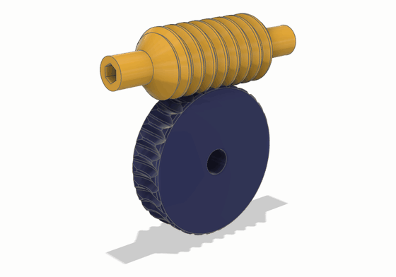

Generates a worm and its worm wheel, parametric and designed to print without supports. The wheel is not drawn by eye: its teeth are cut by the **exact envelope of the worm**, so they come out smooth (about 6 faces per tooth) and do not interfere.

## 🧩 Two versions, the same math

| [**Fusion 360**](fusion/README.en.md) | [**FreeCAD**](freecad/README.en.md) |
|---|---|
| 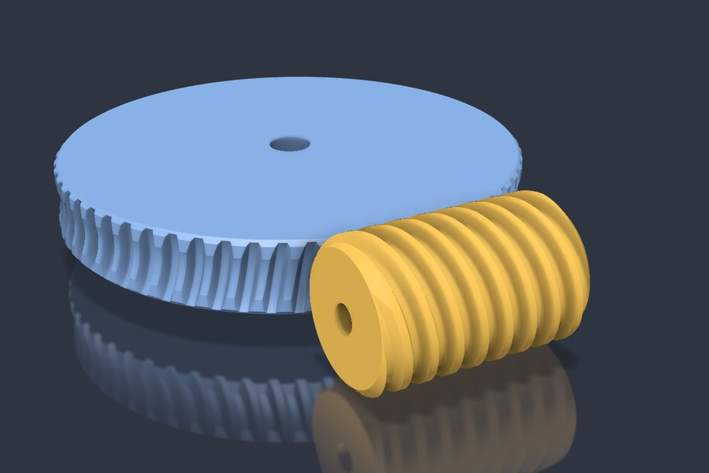 | 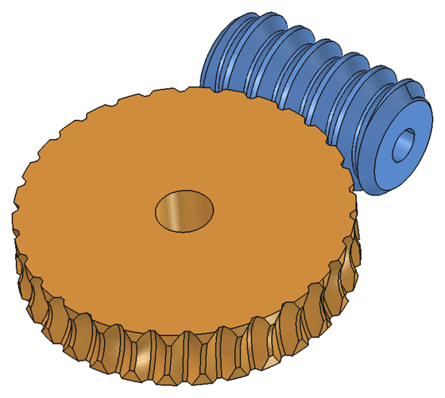 |
| Add-in with a dialog and a live summary. In assemblies it creates revolute joints and a motion link with the ratio: drag the worm and the wheel turns. | Workbench with parametric objects: change a property and it recomputes. |
| **Install:** zip from the [Releases](https://github.com/buho29/wormgear/releases) with `instalar.bat`. → [more](fusion/README.en.md#installation) | **Install:** Addon Manager (custom repository) or copy into `Mod`. → [more](freecad/README.en.md#installation) |

The math lives in `wormgear/geometry.py`, which does not depend on any CAD and is the same in both versions, like the English texts in `wormgear/i18n.py` (the FreeCAD tests warn if the copies stop matching). What changes is how each program builds the solids.

## ✨ Features

- 🦷 **Smooth, exact wheel:** each tooth is a loft of profiles computed in closed form, not hundreds of subtractions.
- 📐 **Automatic 45° chamfer** on the wheel faces, where the teeth get low.
- ⚠️ **Warnings** while you choose the values: thin worm crest, throat past 45°, overhangs, undercut, pointed teeth and thin hub. With an error it will not generate.
- 🔍 **Mesh check:** measures the interference at 8 positions and the real backlash between flanks.
- 🔄 **Right- or left-handed:** the left-handed version is the mirror image, just as exact.
- 🔩 **Bores:** round, D flat (motor shafts), hexagonal, square or with a DIN 6885 keyway.
- 🛞 **Plain ends on the worm:** the thread can be shorter than the worm, so the ends can sit in bearings.
- 🌐 **Spanish or English:** the dialog, properties, warnings and part names are in Spanish if Fusion or FreeCAD is in Spanish, and in English for any other language.
- 🖨️ **Made for printing:** with the defaults (45° flank and stub tooth), the worm prints standing and the wheel lying flat, both without supports.

## ⚖️ Compared with other ways of drawing the wheel

The three wheels have the same set: m1.5, 30 teeth, 1 start, 20° flank and full-depth tooth. They are shown in sections parallel to the mid-plane, with the worm in blue, the wheel in orange and the interference in red, at the position with the least interference.

- **Helical gear with a throat.** The tooth is an involute twisted along a helix and then trimmed by the throat. It fits in the mid-plane, but away from it it does not follow the worm and the flanks collide.
- **Single cut.** The still worm is subtracted from the blank and the gap of one tooth is repeated around. The middle gap fits, but the others end up turned against their threads, because the worm is straight and the wheel is round, and the tooth tips run into them.
- **WormGear.** The gap is the envelope of everything the worm sweeps while both turn: no interference, and the requested backlash.

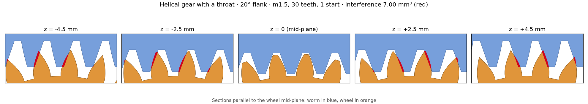

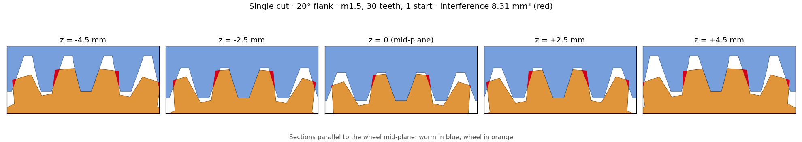

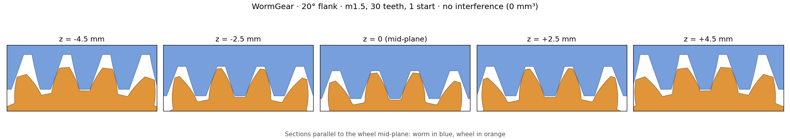

The measurements at 8 positions and the 30° test are in the [comparison](comparativa.en.md#test-with-the-same-set-gearworkbench-and-wormgear).

## 📐 Which flank angle to choose

The flank angle is the **pressure angle** in the axial section of the worm (the one in the standards, usually 20°). It is called flank here because that is what shows when printing: with the worm standing, the underside of the thread is tilted that same angle above the horizontal, and it is the number to compare with the slicer's overhang threshold (PrusaSlicer, OrcaSlicer, Bambu Studio). In Cura, which measures it from the vertical, it is 90° minus the flank.

Besides the overhang, the flank sets how efficient the gear is and how hard the wheel pushes against the worm.

| Flank | Efficiency, 1 start (greased / dry) | Efficiency, 2 starts (greased / dry) | Radial force | Self-locks up to (greased / dry) |
|---|---|---|---|---|
| 20° | 46 % / 22 % | 63 % / 35 % | 1× | 6.1° / 17.7° lead angle |
| 30° | 44 % / 21 % | 61 % / 33 % | 1.6× | 6.6° / 19.1° lead angle |
| 45° (default) | 39 % / 17 % | 56 % / 28 % | 2.7× | 8.0° / 22.9° lead angle |

Default set (m1.5, 30 teeth, worm pitch Ø 16 mm): 5.4° lead angle with 1 start and 10.6° with 2. Greased is μ 0.1 and dry, μ 0.3. The radial force, which pushes the worm away from the wheel, is at the same torque and relative to 20°.

- **Efficiency:** from 20° to 45° it drops about 7 points (from 46 % to 39 % with 1 start, greased). The number of starts matters much more: with 2, the lead angle goes from 5.4° to 10.6° and the efficiency rises about 16 points, at the cost of half the reduction and no self-locking when greased.
- **Radial force:** at 45° it is almost three times that at 20°. The shafts and their supports have to take it; if they give, the mesh opens.
- **Self-locking:** with 1 start, the wheel cannot drive the worm with any flank, not even greased. With 2 starts it only self-locks dry. With vibration, a self-locking worm can still back-drive.
- **Is higher efficiency better?** Almost always: less heat (PLA softens around 55–60 °C), less wear and a smaller motor is enough. Except when it has to hold the load while stopped, like a lift or a lid: a self-locking worm is less than 50 % efficient, and there 1 start is the way to go.

Recommendation:
- **PLA or PETG: 30°.** With the part cooling fan, they handle faces at 30° from the horizontal well without supports. It is a little more efficient than 45° and the radial force drops by 40 %.
- **ABS or ASA: 45°.** They are printed with little fan, because they shrink and crack if they cool quickly, and so faces flatter than 45° come out badly.

These are estimates: the friction of printed plastic varies a lot. There is more detail in the [comparison](comparativa.en.md#efficiency-with-a-45-flank).

## 🔧 Parameters

They are the same in both versions. In Fusion they are in the dialog; in FreeCAD they are properties of the object.

| Group | Parameter | FreeCAD property | Default |
|---|---|---|---|
| Gear | Module (axial) | `Module` | 1.5 mm |
| | Worm starts | `Starts` | 1 |
| | Wheel teeth | `Teeth` | 30 |
| | Worm pitch Ø | `Worm Pitch Diameter` | 16 mm |
| | Flank angle (axial) | `Flank Angle` | 45° (no overhangs over 45° with the worm standing) |
| | Addendum / dedendum (× module) | `Addendum Factor` / `Dedendum Factor` | 0.5 / 0.6 (stub tooth: at 45° a full-depth one comes to a point) |
| | Radial clearance | `Clearance` | 0.15 mm |
| | Backlash | `Backlash` | 0.1 mm |
| | Left-handed | `Left Handed` | no |
| Worm | Length | `Worm Length` | 30 mm |
| | Threaded length (0 = all) | `Thread Length` | 0 |
| | Plain ends Ø (0 = thread root minus 0.6 mm) | `Shoulder Diameter` | 0 |
| | Bore: shape, Ø or across flats, D flat | `Worm Bore Shape`, `Worm Bore`, `Worm Bore Flat` | round, 5.1 mm (flat at 4.6 mm) |
| Wheel | Width | `Wheel Width` | 10 mm |
| | Bore: shape, Ø or across flats, D flat | `Wheel Bore Shape`, `Wheel Bore`, `Wheel Bore Flat` | round, 8.1 mm (flat at 7.6 mm) |
| | Rim over tip | `Rim Over Tip` | 0.63 mm |
| | Loft sections | `Sections` | 23 |

Bores:
- **round**, **D flat** and **keyway** are sized by Ø; **hexagonal** and **square**, across flats;
- for the **D flat**, the size is from the flat to the opposite side: for a 5 mm motor shaft with the flat at 4.5 mm, use 5.1 and 4.6 (with the 0.1 printing clearance);
- the **keyway** comes from the DIN 6885 table with the Ø rounded, with 0.1 mm of clearance in width and depth;
- they are all vertical when printing (worm standing, wheel lying flat), so they add no overhangs.

The **plain ends** go on both sides of the thread, which stays centered. If they are thinner than the core, the step is at 45°. The thread must cover the whole zone the wheel enters: if it is shorter, you get an error that gives the minimum.

With the values entered, both versions show the gear ratio, the center distance, the lead angle with the hand, the diameters and the warnings. They also estimate the **efficiency** greased (μ 0.1) and dry (μ 0.3), and say whether the wheel can drive the worm (**self-locking**: tan λ ≤ μ / cos αn, with αn the normal pressure angle). With a 45° flank, the efficiency is somewhat lower than with 20°, but it self-locks up to a larger lead angle ([more](comparativa.en.md#efficiency-with-a-45-flank)). These are estimates: the friction of plastic varies a lot, and with vibration a self-locking worm can back-drive.

## 🔍 Mesh check

With temporary bodies, without touching the parts:
- it measures the common volume of worm and wheel at 8 positions over one tooth pitch;
- it measures how far the worm turns, with the wheel held still, until it touches on each side (the backlash).

Results of the FreeCAD tests (`freecad/tests/run_tests.py`):

| Set | Faces per tooth | Interference | Measured backlash (requested 0.100 mm) |
|---|---|---|---|
| m1.5, 30 teeth, 1 start, 45° (default) | 6.2 | 0 mm³ | 0.104 mm |
| m2, 20 teeth, 2 starts, 30° | 6.2 | 0 mm³ | 0.101 mm |
| m1.5, 60 teeth, 3 starts, 30° | 6.1 | 0 mm³ | 0.102 mm |
| m1.5, 30 teeth, 1 start, 20° with full-depth tooth (addendum 1·m, dedendum 1.25·m) | 6.2 | 0 mm³ | 0.100 mm |
| m1.5, 30 teeth, 2 starts, 45°, **left-handed**, 26 mm thread on a 40 mm worm with Ø10 plain ends, hexagonal bore in the worm and D-flat bore in the wheel | 6.2 | 0 mm³ | 0.100 mm |

In Fusion, all five sets gave 0 mm³ and a backlash of 0.099 to 0.100 mm. With the defaults, that is ±3.8° of worm rotation. With the left-handed set and the motion link, the wheel turns the other way without colliding.

## 🧮 How the wheel is computed

The wheel is not drawn by eye, nor machined with hundreds of subtractions.

The first attempt was to machine it: subtract the worm from the disc at many positions, turning both with the ratio, as a hob would. It works, but each subtraction leaves its own facet: the tooth comes out with hundreds of thin faces (the stripes on the left), the model is heavy and the flanks are stepped. With the computed envelope, the same tooth comes out with about 6 smooth faces (right).

| First attempt: subtractions | Now: envelope and loft |
|---|---|
| 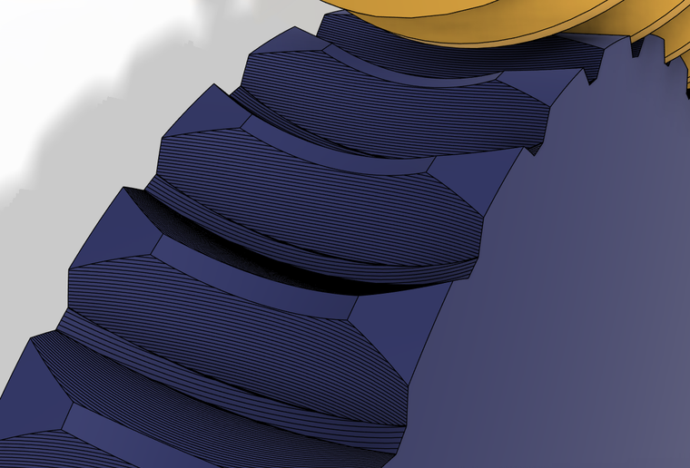 | 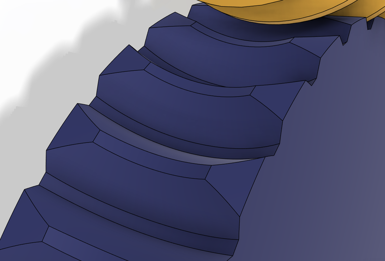 |

This is how it is computed.

The diagrams are of the default set (m1.5, 30 teeth, 1 start, 45° flank) and come from the same math: `python img/diagramas.py`. Their labels are in Spanish.

**1. Cut with planes.** For each plane z = c parallel to the mid-plane of the wheel, the "cutter" is cut with that plane: the worm with each flank thickened by half the backlash and the tip a little higher.

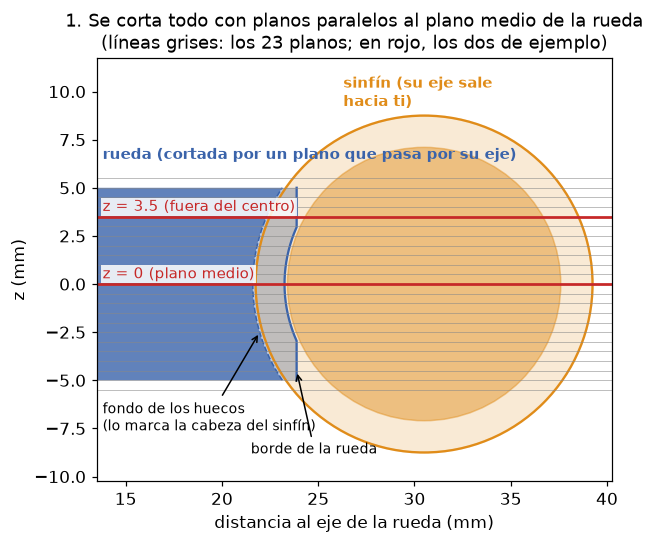

**2. In each plane, the worm is a rack.** When it turns, the worm thread, which is a helicoid, only slides along its axis without leaving the plane. The wheel turns about Z, so the plane does not move either. That is why what happens in each plane is a 2D rack-and-pinion mesh, and its envelope is that of the real 3D mesh, also away from the center.

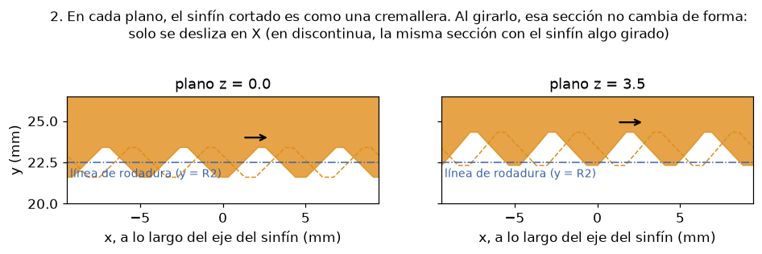

This is what it looks like in the mid-plane of a generated set (30:1), cut in Fusion while it turns:

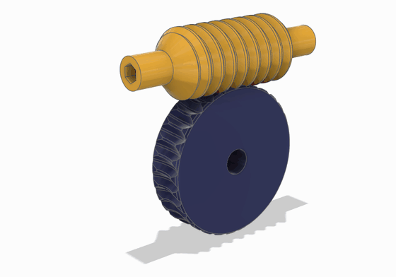

**3. The tooth gap is what the worm sweeps.** Seen from the wheel, as if it were still, the worm rolls past in front of it. The tooth gap is the envelope of all its positions: exactly the shape the thread needs to enter without touching.

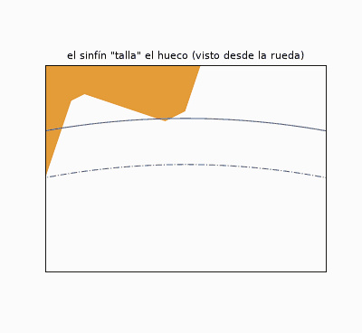

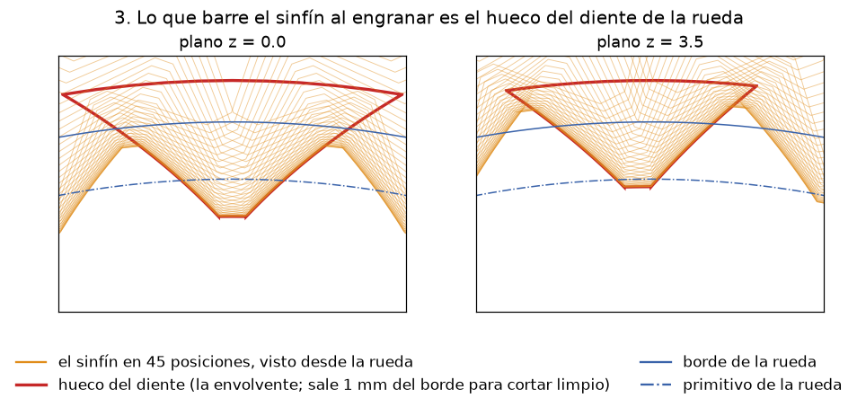

**4. The envelope is computed without simulating.** No positions need to be tried. For each point of the worm flank, there is a single wheel rotation at which that point is the contact point: the one where the normal to the flank passes through the pitch point P. Solving for it gives a closed formula (`geometry.gap_profile`), and with it each point of the flank gives a point of the gap.

The root of the tooth is cut by the corner of the worm tip, which traces a **trochoid** from the bottom of the gap as it rolls. At 45° it hardly shows, but with a small flank angle (20°) the envelope does not reach the bottom and that stretch is all trochoid. At each radius, the gap flank is whichever of the two curves goes further into the tooth.

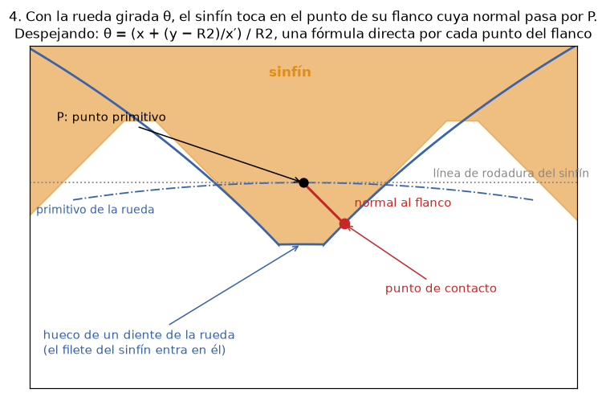

**5. Loft, pattern and cut.** Each plane gives the closed profile of one tooth gap: two splines, the root arc and the outer arc. A **loft** joins the profiles into a solid. Then a circular pattern is made and the blank disc, which carries the toroidal throat, is cut.

| The computed profiles | The loft in Fusion |
|---|---|
| 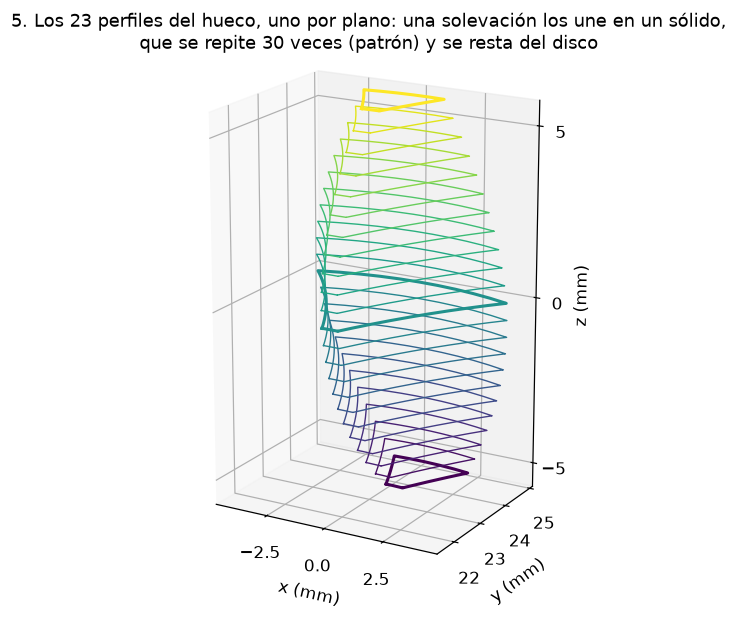 | 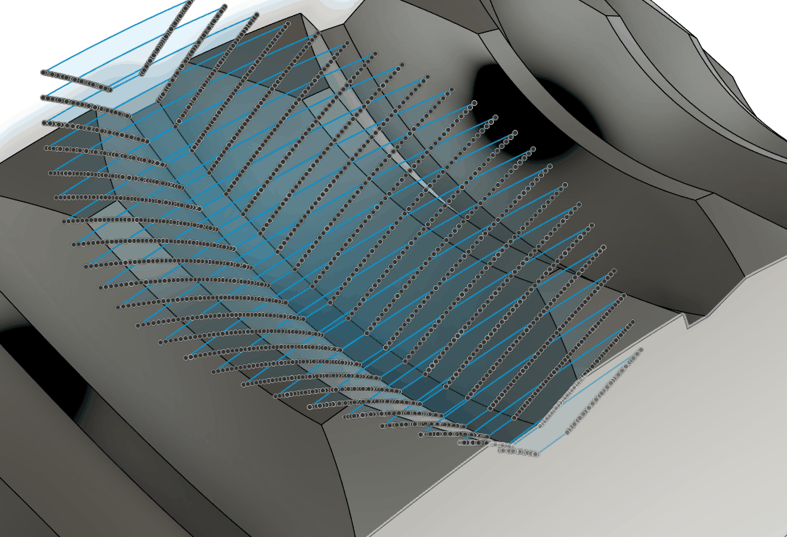 |

On the right, the loft of one gap in Fusion: each sketch is one plane, with the points of its two splines, and the blue surface is the gap that joins them.

Near the faces, the worm reaches less and less and the teeth get low and weak. That is why the disc has a **45° chamfer on both faces**:
- it starts where the tooth drops below half its height at the center;
- it is left out if it would remove less than 0.3 mm;
- with the wheel lying flat, it prints without supports.

The result is about 6 faces per tooth.

**Left-handed** needs no other calculation: it is computed right-handed and mirrored about the plane that contains the worm axis and is perpendicular to the wheel axis. The mirror image of an interference-free mesh is another interference-free mesh; only the wheel's direction of rotation changes.

<b>📚 Where the method comes from</b>

 

It is not copied from any particular program or document. It was developed for this project, from classical gear theory. This is what comes from the theory and what was worked out here:

- **Cutting with planes parallel to the worm axis** (the planes parallel to the mid-plane of the wheel) is a classical method. In each of those planes, the section of the thread is a rack and the wheel meshes with it like a spur pinion. This is how Earle Buckingham and Henry H. Ryffel present it in *Design of Worm and Spiral Gears* (Industrial Press, 1960; reprinted by Buckingham Associates). Stadtfeld and Errichello summarize it in [*Conjugate Gears*](https://www.geartechnology.com/conjugate-gears) (Gear Technology, 2023).
- **That the result is exact also away from the center** was reasoned here: turning a helicoid about its axis is the same as sliding it along that axis. A plane z = c contains the direction of the worm axis, so the section does not change shape, it only slides in X. The wheel turns about Z, perpendicular to the plane, and the motion stays entirely within the plane. That is why the 2D envelope of each plane is that of the real 3D mesh.
- **The formula θ = (x + (y − R2)/x′)/R2** is the rack-and-pinion meshing equation: the contact is at the point of the flank whose normal passes through the pitch point. In the general theory it is written as "the normal is perpendicular to the relative velocity" (F. L. Litvin's equation of meshing, in *Gear Geometry and Applied Theory*). The closed form for this flank was derived here.
- **The root trochoid** comes from the theory of generating cutting: the corner of the tool cuts a root that the envelope alone does not give (it is what undercuts pinions with few teeth).
- **The construction** (profiles per plane, loft, pattern, cut and chamfer) is the project's own. In Fusion it is done with splines and timeline features; in FreeCAD, with OCCT ([the differences](freecad/README.en.md#how-it-is-built)).

What really backs it up is not a citation, but the check with the real CAD bodies: 0 mm³ of interference at 8 positions and a measured backlash equal to the requested clearance, in Fusion and in FreeCAD ([results](#-mesh-check)).

## 📁 What is in the repo

| Folder | What it is |
|---|---|
| [`fusion/`](fusion/README.en.md) | The Fusion 360 add-in: code, installer and its README. |
| [`freecad/`](freecad/README.en.md) | The FreeCAD workbench: code, tests and its README. |
| `img/` | The diagrams of the calculation. `img/diagramas.py` draws them with matplotlib from `fusion/wormgear/geometry.py`. |
| `package.xml` | The metadata for the FreeCAD Addon Manager. |
| [`comparativa.en.md`](comparativa.en.md) | What other worm gear generators do (Fusion, FreeCAD, Onshape, Inventor, OpenSCAD). |

The code identifiers are in English; the comments are in Spanish.

## 📄 License

[MIT](LICENSE).
