

# ⚙️ WormGear

### Sinfín y rueda dentada para imprimir en 3D, sin soportes

**Español** · [English](README.en.md)

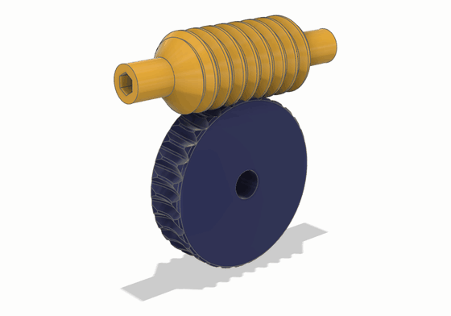

Genera un tornillo sin fin y su rueda dentada, paramétricos y pensados para imprimir sin soportes. La rueda no se dibuja a ojo: sus dientes se tallan con la **envolvente exacta del sinfín**, así que salen lisos (unas 6 caras por diente) y no interfieren.

## 🧩 Dos versiones, la misma matemática

| [**Fusion 360**](fusion/README.md) | [**FreeCAD**](freecad/README.md) |
|---|---|
| 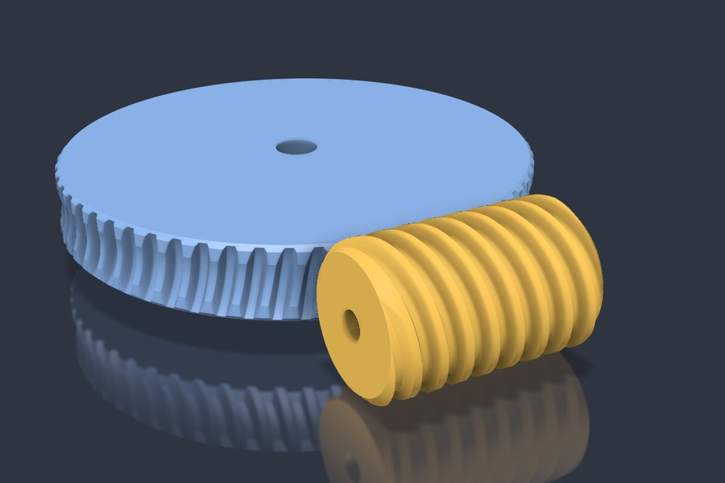 | 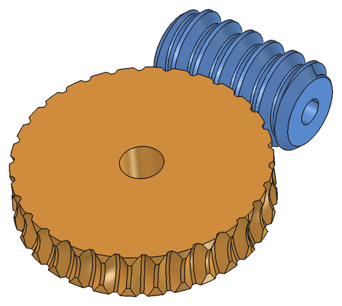 |
| Add-in con diálogo y resumen en vivo. En ensamblajes crea juntas de giro y un enlace de movimiento con la relación: arrastras el sinfín y gira la rueda. | Banco de trabajo con objetos paramétricos: cambias una propiedad y se recalcula. |
| **Instalación:** zip de las [Releases](https://github.com/buho29/wormgear/releases) con `instalar.bat`. → [más](fusion/README.md#instalación) | **Instalación:** gestor de complementos (repositorio personalizado) o copia en `Mod`. → [más](freecad/README.md#instalación) |

La matemática está en `wormgear/geometry.py`, que no depende de ningún CAD y es igual en las dos versiones, como los textos en inglés de `wormgear/i18n.py` (las pruebas de FreeCAD avisan si las copias dejan de coincidir). Lo que cambia es cómo se construyen los sólidos en cada programa.

## ✨ Qué trae

- 🦷 **Rueda lisa y exacta:** cada diente es una solevación de perfiles calculados con fórmula cerrada, no cientos de restas.
- 📐 **Chaflán automático de 45°** en las caras de la rueda, donde los dientes salen bajos.
- ⚠️ **Avisos** mientras eliges los valores: cresta del sinfín muy fina, garganta de más de 45°, voladizos, socavado, dientes en punta y poco cubo. Con un error no deja generar.
- 🔍 **Comprobación del engrane:** mide la interferencia en 8 posiciones y el juego real entre flancos.
- 🔄 **A derechas o a izquierdas:** la versión a izquierdas es la simétrica, igual de exacta.
- 🔩 **Taladros** redondos, con plano en D (ejes de motor), hexagonales, cuadrados o con chavetero DIN 6885.
- 🛞 **Tramos lisos en el sinfín:** el filete puede ser más corto que el sinfín, para apoyar los extremos en rodamientos.
- 🌐 **En castellano o en inglés:** el diálogo, las propiedades, los avisos y los nombres de las piezas salen en castellano si Fusion o FreeCAD lo están, y en inglés con cualquier otro idioma.
- 🖨️ **Pensado para imprimir:** con los valores por defecto (flanco de 45° y diente bajo), el sinfín se imprime de pie y la rueda tumbada, los dos sin soportes.

## ⚖️ Frente a otras formas de dibujar la rueda

Las tres ruedas tienen el mismo montaje: m1.5, 30 dientes, 1 entrada, 20° de flanco y diente normal. Se ven en cortes paralelos al plano medio, con el sinfín en azul, la rueda en naranja y el choque en rojo, en la posición con menos choque.

- **Engranaje helicoidal con garganta.** El diente es una involuta girada a lo largo de una hélice y luego recortada por la garganta. En el plano medio encaja, pero lejos de él no sigue al sinfín y chocan los flancos.
- **Un solo corte.** Se resta el sinfín quieto al disco y el hueco de un diente se repite alrededor. El hueco del centro encaja, pero los demás quedan girados respecto a sus filetes, porque el sinfín es recto y la rueda redonda, y las puntas de los dientes se meten en ellos.
- **WormGear.** El hueco es la envolvente de todo lo que barre el sinfín mientras giran los dos: no choca y deja el juego pedido.

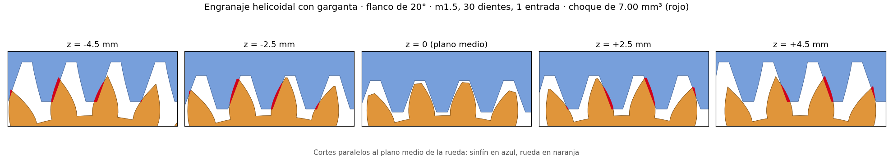

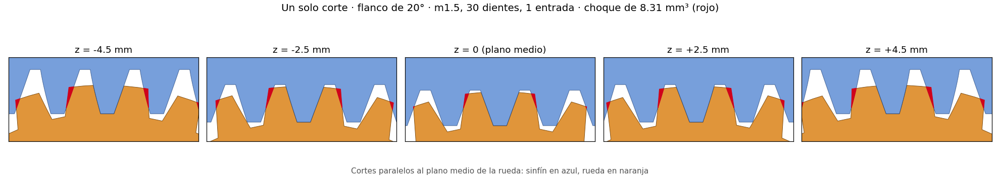

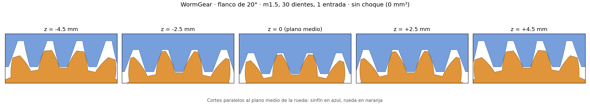

Las medidas en 8 posiciones y la prueba a 30° están en la [comparativa](comparativa.md#prueba-con-el-mismo-montaje-gearworkbench-y-wormgear).

## 📐 Qué ángulo de flanco elegir

El ángulo de flanco es el **ángulo de presión** en la sección axial del sinfín (el de las normas, que suele ser 20°). Aquí se llama flanco porque es lo que se ve al imprimir: con el sinfín de pie, la cara de abajo del filete queda inclinada ese mismo ángulo sobre la horizontal, y es el número que se compara con el umbral de voladizo del laminador (PrusaSlicer, OrcaSlicer, Bambu Studio). En Cura, que lo mide desde la vertical, es 90° menos el flanco.

Además del voladizo, el flanco decide cuánto rinde el engrane y cuánto empuja la rueda contra el sinfín.

| Flanco | Rendimiento, 1 entrada (grasa / seco) | Rendimiento, 2 entradas (grasa / seco) | Fuerza radial | Se autobloquea hasta (grasa / seco) |
|---|---|---|---|---|
| 20° | 46 % / 22 % | 63 % / 35 % | 1× | 6.1° / 17.7° de hélice |
| 30° | 44 % / 21 % | 61 % / 33 % | 1.6× | 6.6° / 19.1° de hélice |
| 45° (por defecto) | 39 % / 17 % | 56 % / 28 % | 2.7× | 8.0° / 22.9° de hélice |

Juego por defecto (m1.5, 30 dientes, Ø primitivo del sinfín 16 mm): hélice de 5.4° con 1 entrada y de 10.6° con 2. Grasa es μ 0.1 y seco, μ 0.3. La fuerza radial, la que separa el sinfín de la rueda, va con el mismo par y relativa a 20°.

- **Rendimiento:** de 20° a 45° baja unos 7 puntos (del 46 % al 39 % con 1 entrada y grasa). Cuentan mucho más las entradas: con 2, la hélice pasa de 5.4° a 10.6° y el rendimiento sube unos 16 puntos, a cambio de reducir la mitad y de no autobloquearse con grasa.
- **Fuerza radial:** con 45° es casi el triple que con 20°. Los ejes y sus apoyos tienen que aguantarla; si ceden, el engrane se abre.
- **Autobloqueo:** con 1 entrada, la rueda no puede mover el sinfín con ningún flanco, ni siquiera con grasa. Con 2 entradas solo se autobloquea en seco. Con vibraciones, un sinfín autobloqueante puede volver atrás.

Recomendación:
- **PLA o PETG: 30°.** Con el ventilador de capa, aguantan bien caras a 30° de la horizontal sin soportes. Rinde un poco más que 45° y la fuerza radial baja un 40 %.
- **ABS o ASA: 45°.** Se imprimen con poco ventilador, porque si se enfrían deprisa encogen y se agrietan, y así las caras más tumbadas de 45° salen mal.

Son estimaciones: el rozamiento del plástico impreso varía mucho. Hay más detalle en la [comparativa](comparativa.md#rendimiento-con-flanco-de-45).

## 🔧 Parámetros

Son los mismos en las dos versiones. En Fusion salen en el diálogo; en FreeCAD son propiedades del objeto, con el nombre en inglés.

| Grupo | Parámetro | Propiedad en FreeCAD | Por defecto |
|---|---|---|---|
| Engrane | Módulo (axial) | `Module` | 1.5 mm |
| | Entradas del sinfín | `Starts` | 1 |
| | Dientes de la rueda | `Teeth` | 30 |
| | Ø primitivo del sinfín | `Worm Pitch Diameter` | 16 mm |
| | Ángulo de flanco (axial) | `Flank Angle` | 45° (sin voladizos de más de 45° con el sinfín de pie) |
| | Cabeza / pie (× módulo) | `Addendum Factor` / `Dedendum Factor` | 0.5 / 0.6 (diente bajo: con 45° uno normal acaba en punta) |
| | Holgura radial | `Clearance` | 0.15 mm |
| | Holgura entre flancos | `Backlash` | 0.1 mm |
| | A izquierdas | `Left Handed` | no |
| Sinfín | Longitud | `Worm Length` | 30 mm |
| | Longitud con filete (0 = todo) | `Thread Length` | 0 |
| | Ø de los tramos lisos (0 = el fondo del filete menos 0.6 mm) | `Shoulder Diameter` | 0 |
| | Taladro: forma, Ø o entre caras, plano en D | `Worm Bore Shape`, `Worm Bore`, `Worm Bore Flat` | redondo, 5.1 mm (plano a 4.6 mm) |
| Rueda | Ancho | `Wheel Width` | 10 mm |
| | Taladro: forma, Ø o entre caras, plano en D | `Wheel Bore Shape`, `Wheel Bore`, `Wheel Bore Flat` | redondo, 8.1 mm (plano a 7.6 mm) |
| | Borde sobre la cabeza | `Rim Over Tip` | 0.63 mm |
| | Perfiles de la solevación | `Sections` | 23 |

Los taladros:
- **redondo**, **plano en D** y **chavetero** se miden por el Ø; **hexagonal** y **cuadrado**, entre caras;
- en el **plano en D**, la medida es del plano al lado opuesto: para un eje de motor de 5 mm con el plano a 4.5 mm, 5.1 y 4.6 (con la holgura de 0.1 de impresión);
- el **chavetero** sale de la tabla DIN 6885 con el Ø redondeado, con 0.1 mm de holgura en el ancho y en el fondo;
- todos quedan verticales al imprimir (sinfín de pie y rueda tumbada), así que no añaden voladizos.

Los **tramos lisos** van a los dos lados del filete, que queda centrado. Si son más finos que el núcleo, el escalón es de 45°. El filete tiene que cubrir toda la zona en la que entra la rueda: si es más corto, da error y dice el mínimo.

Con los valores puestos, las dos versiones muestran la relación de transmisión, la distancia entre ejes, el ángulo de hélice con la mano, los diámetros y los avisos. También estiman el **rendimiento** con grasa (μ 0.1) y en seco (μ 0.3), y dicen si la rueda puede mover el sinfín (**autobloqueo**: tan λ ≤ μ / cos αn, con αn el ángulo de presión normal). Con 45° de flanco, el rendimiento es algo menor que con 20°, pero se autobloquea con más hélice ([más](comparativa.md#rendimiento-con-flanco-de-45)). Son estimaciones: el rozamiento del plástico varía mucho, y con vibraciones un sinfín autobloqueante puede volver atrás.

## 🔍 Comprobación del engrane

Con cuerpos temporales, sin tocar las piezas:
- mide el volumen común entre sinfín y rueda en 8 posiciones de un paso de diente;
- mide cuánto gira el sinfín, con la rueda quieta, hasta tocar por cada lado (el juego).

Resultados de las pruebas de FreeCAD (`freecad/tests/run_tests.py`):

| Juego | Caras por diente | Interferencia | Juego medido (pedido 0.100 mm) |
|---|---|---|---|
| m1.5, 30 dientes, 1 entrada, 45° (por defecto) | 6.2 | 0 mm³ | 0.104 mm |
| m2, 20 dientes, 2 entradas, 30° | 6.2 | 0 mm³ | 0.101 mm |
| m1.5, 60 dientes, 3 entradas, 30° | 6.1 | 0 mm³ | 0.102 mm |
| m1.5, 30 dientes, 1 entrada, 20° con diente normal (cabeza 1·m, pie 1.25·m) | 6.2 | 0 mm³ | 0.100 mm |
| m1.5, 30 dientes, 2 entradas, 45°, **a izquierdas**, filete de 26 mm en un sinfín de 40 con tramos lisos de Ø10, taladro hexagonal en el sinfín y con plano en D en la rueda | 6.2 | 0 mm³ | 0.100 mm |

En Fusion, los cinco juegos dieron 0 mm³ y un juego de 0.099 a 0.100 mm. Con los valores por defecto, eso son ±3.8° de giro del sinfín. Con el juego a izquierdas y el enlace de movimiento, la rueda gira al revés sin chocar.

## 🧮 Cómo se calcula la rueda

La rueda no se dibuja a ojo, ni se mecaniza con cientos de restas.

El primer intento fue mecanizarla: restar el sinfín del disco en muchas posiciones, girando los dos con la relación, como haría una fresa madre. Funciona, pero cada resta deja su propia faceta: el diente sale con cientos de caras finas (las rayas de la izquierda), el modelo pesa mucho y los flancos quedan escalonados. Con la envolvente calculada, el mismo diente sale con unas 6 caras lisas (derecha).

| Primer intento: restas | Ahora: envolvente y solevación |
|---|---|
| 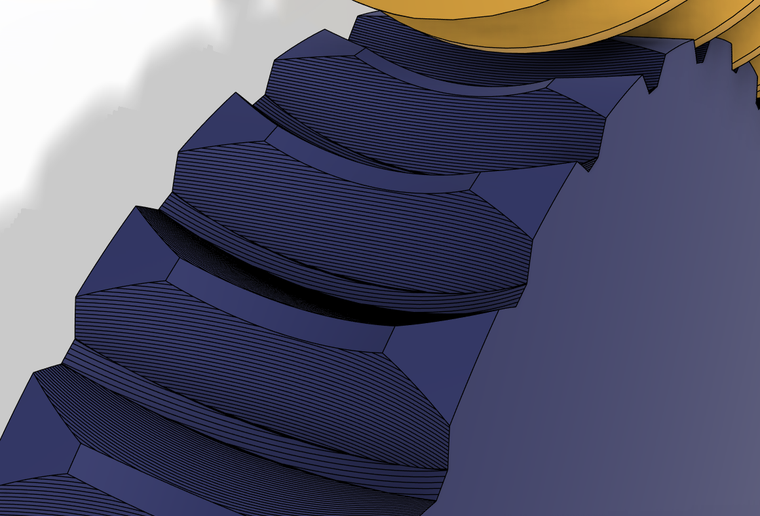 | 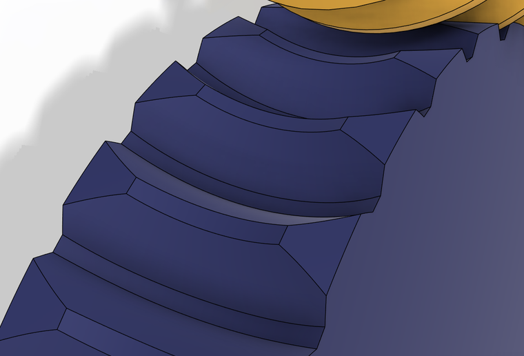 |

Se calcula así.

Los diagramas son del juego por defecto (m1.5, 30 dientes, 1 entrada, flanco de 45°) y salen de la misma matemática: `python img/diagramas.py`.

**1. Se corta con planos.** Para cada plano z = c paralelo al plano medio de la rueda, se corta con ese plano el "cortador": el sinfín con cada flanco engordado media holgura y la cabeza un poco más alta.

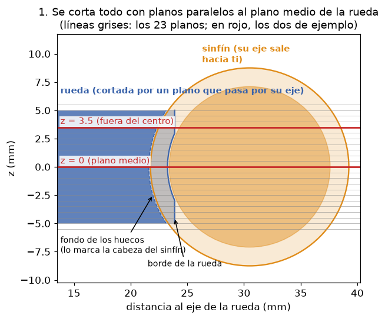

**2. En cada plano, el sinfín es una cremallera.** Al girar, el filete del sinfín, que es un helicoide, solo se desplaza a lo largo de su eje sin salir del plano. La rueda gira alrededor de Z, así que el plano tampoco se mueve. Por eso lo que pasa en cada plano es un engrane 2D de cremallera y piñón, y su envolvente es la del engrane 3D real, también lejos del centro.

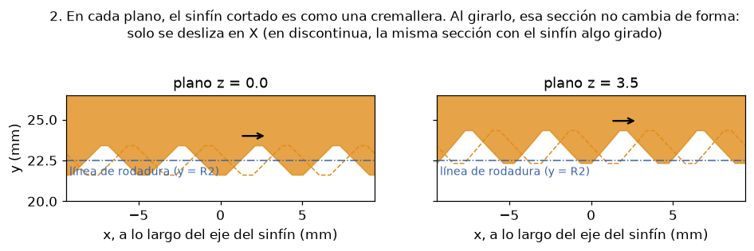

Así se ve en el plano medio de un juego generado (30:1), cortado en Fusion mientras gira:

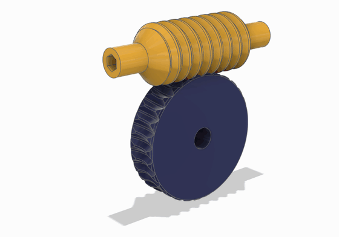

**3. El hueco del diente es lo que barre el sinfín.** Si miras desde la rueda, como si estuviera quieta, el sinfín pasa rodando por delante. El hueco del diente es la envolvente de todas sus posiciones: la forma justa para que el filete entre sin tocar.

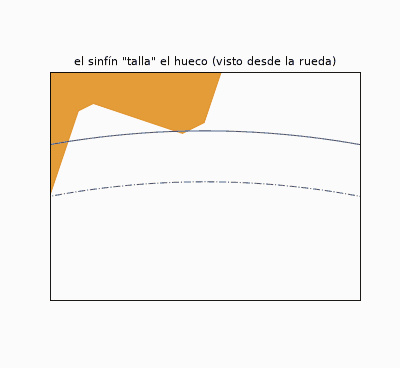

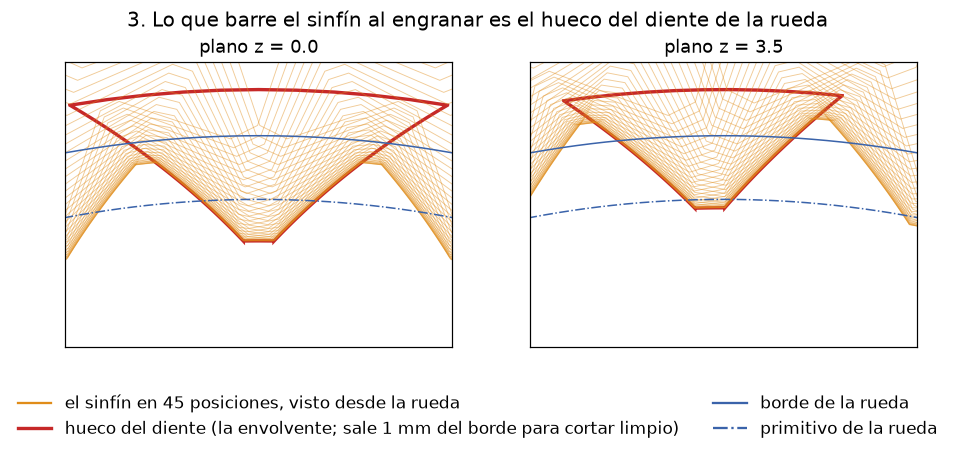

**4. La envolvente se calcula sin simular.** No hace falta probar posiciones. Para cada punto del flanco del sinfín, hay un único giro de la rueda en el que ese punto es el de contacto: aquel en el que la normal al flanco pasa por el punto primitivo P. Despejando sale una fórmula cerrada (`geometry.gap_profile`), y con ella cada punto del flanco da un punto del hueco.

El pie del diente lo talla la esquina de la cabeza del sinfín, que al rodar dibuja una **trocoide** desde el fondo del hueco. Con 45° casi no se nota, pero con poco ángulo de flanco (20°) la envolvente no baja hasta el fondo y ese tramo es todo trocoide. A cada radio, el flanco del hueco es el de las dos curvas que más entra en el diente.

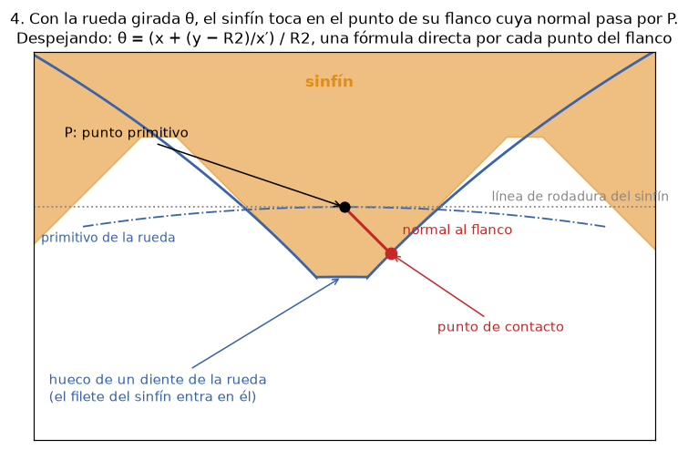

**5. Solevación, patrón y corte.** Cada plano da el perfil cerrado del hueco de un diente: dos splines, el arco de fondo y el arco exterior. Una **solevación** une los perfiles en un sólido. Después se hace un patrón circular y se corta el disco en bruto, que lleva la garganta toroidal.

| Los perfiles calculados | La solevación en Fusion |
|---|---|
| 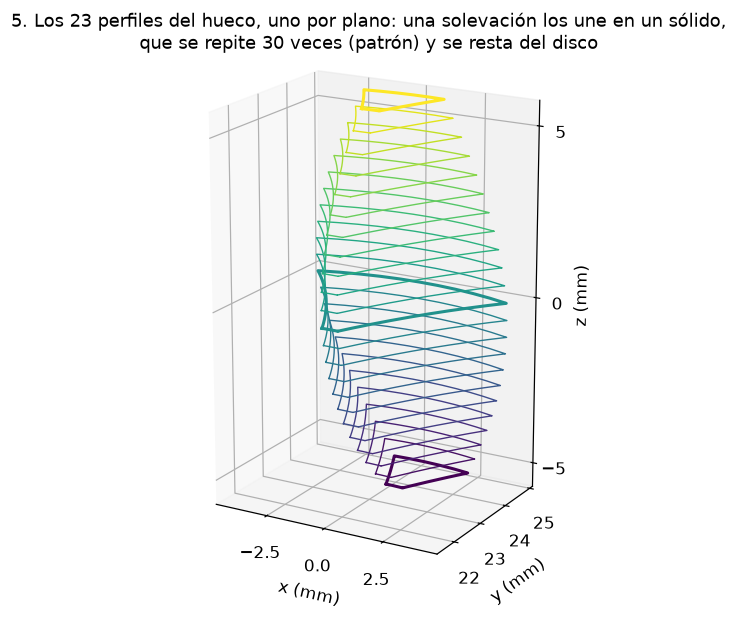 | 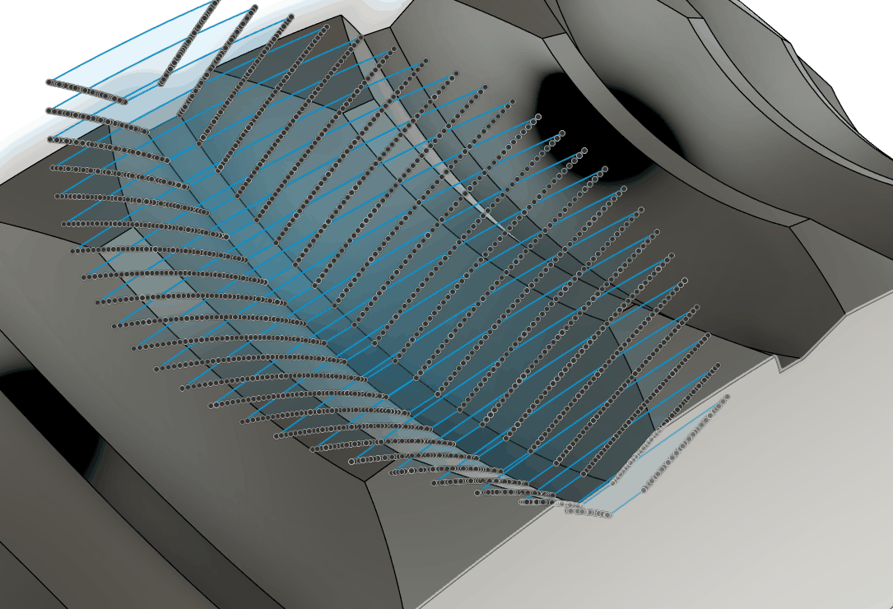 |

A la derecha, la solevación de un hueco en Fusion: cada boceto es un plano, con los puntos de sus dos splines, y la superficie azul es el hueco que los une.

Cerca de las caras, el sinfín llega cada vez menos y los dientes salen bajos y débiles. Por eso el disco lleva un **chaflán de 45° en las dos caras**:
- empieza donde el diente baja de la mitad de su altura del centro;
- no se pone si quitaría menos de 0.3 mm;
- con la rueda tumbada, se imprime sin soportes.

El resultado es de unas 6 caras por diente.

**A izquierdas** no hace falta otra cuenta: se calcula a derechas y se toma el simétrico respecto al plano que pasa por el eje del sinfín y es perpendicular al de la rueda. El simétrico de un engrane sin interferencias es otro engrane sin interferencias; solo cambia el sentido de giro de la rueda.

<b>📚 De dónde sale el método</b>

 

No está copiado de ningún programa ni documento concreto. Se desarrolló para este proyecto, a partir de la teoría clásica de engranajes. Esto es lo que viene de la teoría y lo que se dedujo aquí:

- **Cortar con planos paralelos al eje del sinfín** (que son los paralelos al plano medio de la rueda) es un método clásico. En cada uno de esos planos, la sección del filete es una cremallera y la rueda engrana con ella como un piñón recto. Así lo plantean Earle Buckingham y Henry H. Ryffel en *Design of Worm and Spiral Gears* (Industrial Press, 1960; reeditado por Buckingham Associates). Lo resumen Stadtfeld y Errichello en [*Conjugate Gears*](https://www.geartechnology.com/conjugate-gears) (Gear Technology, 2023).
- **Que el resultado sea exacto también lejos del centro** se razonó aquí: girar un helicoide alrededor de su eje equivale a desplazarlo a lo largo de ese eje. Un plano z = c contiene la dirección del eje del sinfín, así que la sección no cambia de forma, solo se desliza en X. La rueda gira alrededor de Z, perpendicular al plano, y el movimiento queda entero dentro del plano. Por eso la envolvente 2D de cada plano es la del engrane 3D real.
- **La fórmula θ = (x + (y − R2)/x′)/R2** es la ecuación de engrane de cremallera y piñón: toca el punto del flanco cuya normal pasa por el punto primitivo. En la teoría general se escribe como "la normal es perpendicular a la velocidad relativa" (la ecuación de engrane de F. L. Litvin, en *Gear Geometry and Applied Theory*). La forma cerrada para este flanco se dedujo aquí.
- **La trocoide del pie** viene de la teoría de la talla por generación: la esquina de la herramienta talla un pie que la envolvente sola no da (es la que socava los piñones de pocos dientes).
- **La construcción** (perfiles por plano, solevación, patrón, corte y chaflán) es propia del proyecto. En Fusion se hace con splines y operaciones de la línea de tiempo; en FreeCAD, con OCCT ([sus diferencias](freecad/README.md#cómo-se-construye)).

Lo que de verdad lo respalda no es una cita, sino la comprobación con los cuerpos reales del CAD: 0 mm³ de interferencia en 8 posiciones y un juego medido igual a la holgura pedida, en Fusion y en FreeCAD ([resultados](#-comprobación-del-engrane)).

## 📁 Qué hay en el repo

| Carpeta | Qué es |
|---|---|
| [`fusion/`](fusion/README.md) | El add-in de Fusion 360: código, instalador y su README. |
| [`freecad/`](freecad/README.md) | El banco de trabajo de FreeCAD: código, pruebas y su README. |
| `img/` | Los diagramas del cálculo. `img/diagramas.py` los dibuja con matplotlib a partir de `fusion/wormgear/geometry.py`. |
| `package.xml` | Los metadatos para el gestor de complementos de FreeCAD. |
| [`comparativa.md`](comparativa.md) | Qué hacen otros generadores de sinfín y rueda (Fusion, FreeCAD, Onshape, Inventor, OpenSCAD). |

## 📄 Licencia

[MIT](LICENSE).
