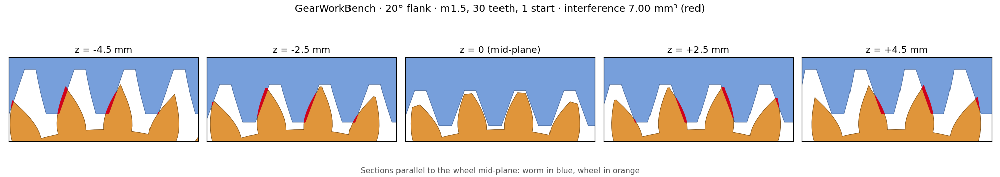
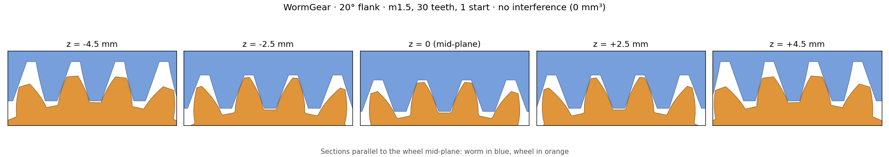
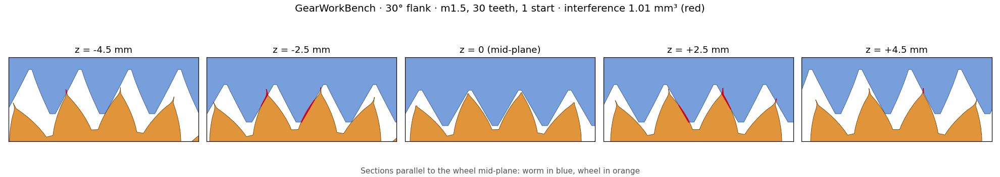
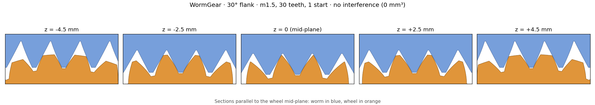
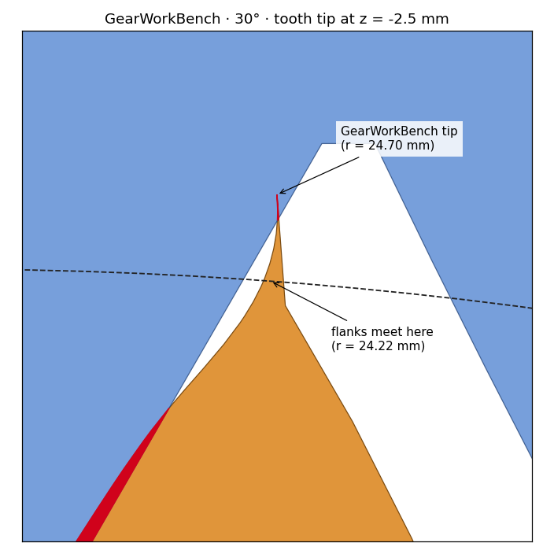
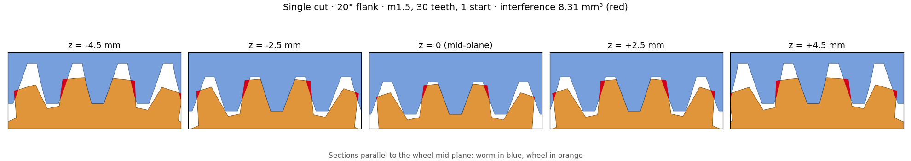
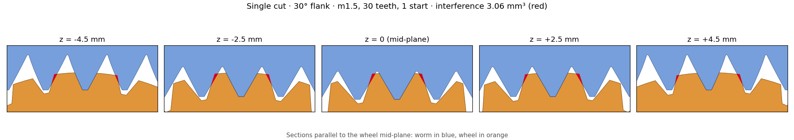

# Other worm gear generators

[Español](comparativa.md) · **English**

What the best-known worm and wheel generators for Fusion 360, FreeCAD, Onshape, Inventor and OpenSCAD do, next to WormGear (v1.2). It is meant to help you pick the one that best fits what you need.

The data on the others comes from their documentation or their code, reviewed on 31/10/2026; I have not run them, except GearWorkBench in the [test below](#test-with-the-same-set-gearworkbench-and-wormgear), and they may have changed. "–" means their documentation does not mention it.

## Table

| | WormGear | [GearWorkBench](https://github.com/iplayfast/GearWorkBench) | [freecad.gears](https://github.com/looooo/freecad.gears) | [Helical Gear+](https://github.com/phossystems/HelicalGearPlus) | [Worm Gear FS](https://forum.onshape.com/discussion/31942/custom-feature-worm-gear) | [Inventor](https://help.autodesk.com/cloudhelp/2026/ENU/Inventor-Help/files/GUID-B0203FE2-C1D4-48C1-A062-9F3B43B75F98.htm) | [BOSL2](https://github.com/BelfrySCAD/BOSL2/wiki/gears.scad) |
|---|---|---|---|---|---|---|---|
| CAD | Fusion 360 and FreeCAD | FreeCAD | FreeCAD | Fusion 360 | Onshape | Inventor | OpenSCAD |
| Wheel | Envelope of the worm, computed per plane, with throat | Straight tooth twisted with the helix (like a helical gear), with throat | Not made: worm only | Helical, non-enveloping | Yes; does not explain how it is computed | Yes, with a simplified tooth curve | Enveloping, simulating the hobbing motion, with crowning |
| Globoid | No | Yes, in a separate generator | No | No | Yes (v2): planar wheel, planar double-enveloping and Hindley | – | Globoid worm yes, with its own wheel |
| Worm profile | Straight flank in the axial section (ZA), 45° by default | Straight flank in the axial section, 20° by default | Pressure angle, 20° by default | – | ZA, ZN and ZI | – | Pressure angle |
| Left-handed | Yes | Yes | Yes | – | – | – | Yes |
| Bores and ends | Round, D, hexagonal, square, DIN 6885 keyway; plain ends | Round, square, hexagonal, DIN 6885 keyway; plain ends | – | – | Shaft and hub; thread end with runout, chamfer or cut | – | – |
| Check | Interference at 8 positions and backlash measured with the solids | Wheel phase set by hand (`WheelPhase`) | – | – | Interference (option) | Strength calculation and check | – |
| Efficiency and self-locking | Estimated, greased and dry | – | – | – | Estimated (v2) | – | – |
| For printing | 45° flank, stub tooth and chamfers, no supports | – | – | – | – | – | – |

## Notes

- **GearWorkBench** has the same kind of worm, with a straight flank in the axial section. Its wheel is a helical gear with a throat, not the envelope: it meshes well in the mid-plane and, away from it, the flanks do not follow the worm and run into it ([test](#test-with-the-same-set-gearworkbench-and-wormgear)). It also makes many other kinds of gears. LGPL-2.1 license.
- **freecad.gears** (FCGear) is the most used gear module in FreeCAD. Of this pair, it only makes the worm.
- **Helical Gear+** is free on the Autodesk App Store. Its description says it makes "non-enveloping" worms and wheels: the wheel is a plain helical gear and the contact with the worm is almost a point. For light loads that is often enough.
- **Worm Gear FS** (an Onshape FeatureScript by Younseo Lee) is recent: v1 and v2 were posted on the Onshape forum in October. v2 adds globoid worms and estimates the efficiency and whether the wheel can drive the worm. It also makes a double worm, with two worms on opposite sides of the wheel.
- **Inventor** (Design Accelerator) is the only one with a strength calculation. Its help says the tooth curve is simplified.
- **BOSL2** generates the enveloping wheel by simulating the hobbing motion, with crowning so the edges are not loaded. Its documentation warns that, away from the mid-plane, the teeth come to a point and the clearance is not uniform across the width. In 2024, on the OpenSCAD mailing list, its worm gears were said to be broken; the current documentation describes the new calculation.

## Test with the same set: GearWorkBench and WormGear

GearWorkBench is the only one on the list that makes this kind of worm and its wheel in FreeCAD. So I ran it (code from 01/10/2026, in FreeCAD 1.1.4) and put its solids through the WormGear check: interference at 8 positions of one tooth and measured backlash.

Set: module 1.5, 1 right-handed start, 30 teeth, worm pitch Ø 16 mm, 10 mm wide wheel, 0.1 mm backlash and full-depth tooth (addendum 1·m, dedendum 1.25·m). I tested it with a 20° flank, which is the standard angle, and with 30°. They cannot be compared at 45°, because GearWorkBench does not generate the thread and leaves the plain core. In WormGear, at 30° I set "rim over tip" to 0: with this tooth, the default value leaves the teeth pointed. GearWorkBench leaves the wheel phase to the user (`WheelPhase`); I turned its worm in 72 steps of 5° and took the position with the least interference.

| Flank | | Interference (8 positions) | Measured backlash (0.1 mm requested) |
|---|---|---|---|
| 20° | GearWorkBench | 7.0 to 7.3 mm³; no position without interference | 0 |
| 20° | WormGear | 0 | 0.100 mm |
| 30° | GearWorkBench | 0.9 to 1.0 mm³; no position without interference | 0 |
| 30° | WormGear | 0 | 0.100 mm |

The images are sections parallel to the wheel mid-plane, at the position with the least interference. The worm is in blue, the wheel in orange and the interference in red.

### At 20°

In GearWorkBench, the mid-plane is clear, but away from it one flank on each side runs into the worm. This is what the note above says: its wheel is a helical gear with a throat and, away from the mid-plane, it does not follow the worm. If the wheel is mirrored about its mid-plane, the interference goes away and 0.22 mm of backlash is left: its teeth seem to twist the opposite way to the worm helix. In WormGear, the clearance is the same across the whole width, and the root of the tooth is cut by the trochoid of the worm tip ([how it is computed](README.en.md#-how-the-wheel-is-computed)).

### At 30°

The same happens, with less interference: in GearWorkBench, the mid-plane is clear and at ±2.5 mm one flank on each side runs into the worm.

#### The spikes at the tips

At the tips of the GearWorkBench teeth there are small red spikes. They belong to the wheel, not the worm. With a 30° flank and a full-depth tooth, the two involutes of a tooth meet 24.22 mm from the axis and the tooth comes to a point. GearWorkBench (`generateToothProfile`, in `gearMath.py`) draws the flank with 12 points between the root (20.48 mm) and an outer radius of 27.11 mm, large so that the throat trims the tips afterwards; that puts one every 0.6 mm. When a point crosses to the other side of the tooth axis, it replaces it with a point on the axis at that same radius, 24.70 mm, and closes the tooth there. So the tooth goes on half a millimetre past where the involutes meet, like a needle.

In the mid-plane, the throat cuts at 24.23 mm and removes the needle. Away from it, the throat is higher (24.74 mm at ±2.5 mm and 26.13 mm at ±4.5 mm) and the whole needle is left. The worm leaves no room for it and rubs it: that is 0.11 of the 1.01 mm³ of interference. The rest, 0.90 mm³, is the flanks running into each other.

Also, the GearWorkBench wheel at 30° is not a valid solid for FreeCAD (`isValid()` is false and `fix()` does not repair it), and FreeCAD warns about it in every boolean; the 20° one is valid. With the 3D boolean, one of the 8 positions gave 0.59 mm³. So I measured them again by adding up the common area of 61 sections parallel to the mid-plane, which does not need a valid solid: they give 0.92 to 0.97 mm³, with no jumps. With that method, GearWorkBench at 20° gives 6.9 to 7.2 mm³, the same as the 3D boolean, and WormGear at 30°, 0 mm³.

## The easy wheel: a single cut of the worm

A very common way to make the wheel by hand is to subtract the still worm from the blank, keep the gap of one tooth and repeat it around. I tested it with the same set and the same WormGear worm as the test above. I subtracted only the middle thread, what falls inside a 12° wedge (one tooth), and repeated the gap 30 times. As in that method, there is no clearance.

| Flank | Interference (8 positions) | Measured backlash (0.1 mm requested) |
|---|---|---|
| 20° | 8.3 to 10.1 mm³; no position without interference | 0 |
| 30° | 3.1 to 4.3 mm³; no position without interference | 0 |

The images are at the cutting position, which has the least interference. The colours are the same as above.

The middle gap is exactly the worm's footprint and does not collide. The others are that gap turned about the wheel axis, while the neighbouring threads are shifted in a straight line, because the worm is straight and the wheel is round. Each copy ends up tilted against its thread, and the tip of the tooth runs into it, in the mid-plane too. As they turn, no gap matches its thread any more. For no interference, the gap has to be the envelope, everything the worm sweeps while both turn, which is what WormGear computes.

At 30°, the OCCT 3D boolean loses volume with this wheel: it gives 1.1 to 3.7 mm³ and jumps with turns of a tenth of a degree. So the interference is measured by adding up the common area of 61 sections parallel to the mid-plane. At 20°, both methods agree (8.40 versus 8.31 mm³).

## What WormGear does not do

- Globoid worms (Onshape, GearWorkBench).
- ZN or ZI flanks (Onshape).
- Double worm (Onshape).
- Strength calculation (Inventor).

## Efficiency with a 45° flank

WormGear uses a 45° flank by default, to print the worm standing without supports. That has a price: with a larger pressure angle, friction weighs more and the efficiency drops. With the default set (1 start, 5.4° lead angle) and μ = 0.05, it gives 57 % with 45° versus 63 % with 20°. The radial force, which pushes the worm away from the wheel, is also about 2.7 times larger (tan 45° versus tan 20°).

In return, it self-locks up to a larger lead angle. The wheel cannot drive the worm if tan λ ≤ μ / cos αn, with αn the normal pressure angle. With μ = 0.1, that reaches a lead angle of about 8° with a 45° flank, and about 6° with 20°.

The WormGear summary gives the efficiency greased (μ 0.1) and dry (μ 0.3), and says whether it self-locks. These are estimates, because the friction of printed plastic varies a lot. With vibration, a self-locking worm can back-drive.

## Sources

- [GearWorkBench](https://github.com/iplayfast/GearWorkBench): code of `wormGear.py`, `globoidWormGear.py` and `gearMath.py`, and the test above with commit `e912ccf`.
- [freecad.gears](https://github.com/looooo/freecad.gears): code of `freecad/gears/wormgear.py`.
- [Helical Gear+](https://github.com/phossystems/HelicalGearPlus) and the [Autodesk App Store](https://apps.autodesk.com/FUSION/en/Home).
- [Worm Gear FS v1](https://forum.onshape.com/discussion/31942/custom-feature-worm-gear) and [v2.0](https://forum.onshape.com/discussion/31969/custom-feature-worm-gear-v2-0-now-supporting-globoid-worm-gears), on the Onshape forum.
- [Inventor: worm gear generator](https://help.autodesk.com/cloudhelp/2026/ENU/Inventor-Help/files/GUID-B0203FE2-C1D4-48C1-A062-9F3B43B75F98.htm), in the Autodesk help.
- [BOSL2: `gears.scad`](https://github.com/BelfrySCAD/BOSL2/wiki/gears.scad) and the [2024 thread](https://lists.openscad.org/empathy/thread/SDRX76E576Y5ER3LS4HURCNH5N2QUDSW) on the OpenSCAD list.
