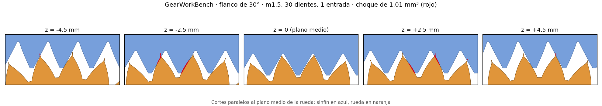
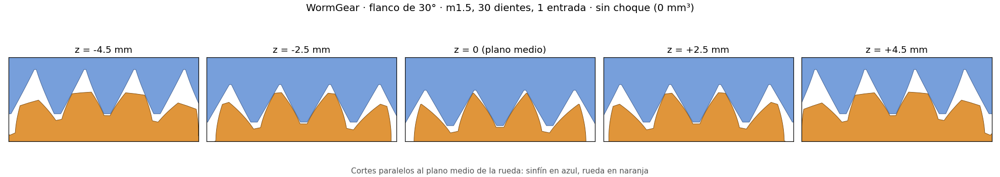
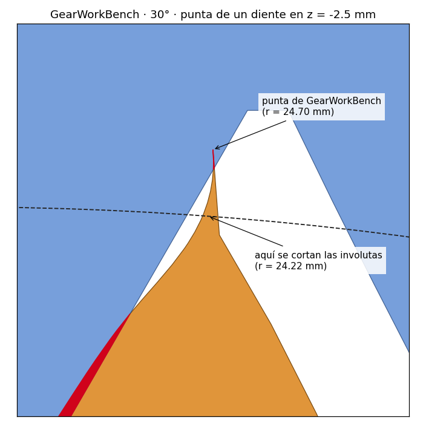

# Otros generadores de sinfín y rueda

**Español** · [English](comparativa.en.md)

Qué hacen los generadores de sinfín y rueda más conocidos de Fusion 360, FreeCAD, Onshape, Inventor y OpenSCAD, junto a WormGear (v1.2). Sirve para elegir el que mejor encaje con lo que necesitas.

Los datos de los demás salen de su documentación o de su código, revisados el 31/10/2026; no los he ejecutado, salvo GearWorkBench en la [prueba de abajo](#prueba-con-el-mismo-montaje-gearworkbench-y-wormgear), y pueden haber cambiado. "–" quiere decir que su documentación no lo menciona.

## Tabla

| | WormGear | [GearWorkBench](https://github.com/iplayfast/GearWorkBench) | [freecad.gears](https://github.com/looooo/freecad.gears) | [Helical Gear+](https://github.com/phossystems/HelicalGearPlus) | [Worm Gear FS](https://forum.onshape.com/discussion/31942/custom-feature-worm-gear) | [Inventor](https://help.autodesk.com/cloudhelp/2026/ENU/Inventor-Help/files/GUID-B0203FE2-C1D4-48C1-A062-9F3B43B75F98.htm) | [BOSL2](https://github.com/BelfrySCAD/BOSL2/wiki/gears.scad) |
|---|---|---|---|---|---|---|---|
| CAD | Fusion 360 y FreeCAD | FreeCAD | FreeCAD | Fusion 360 | Onshape | Inventor | OpenSCAD |
| Rueda | Envolvente del sinfín, calculada por planos, con garganta | Diente recto girado con la hélice (como un helicoidal), con garganta | No la hace: solo el sinfín | Helicoidal, no envolvente | Sí; no explica cómo se calcula | Sí, con la curva del diente simplificada | Envolvente, simulando el movimiento de tallado, con abombado |
| Globoide | No | Sí, en un generador aparte | No | No | Sí (v2): rueda plana, doble envolvente plana y Hindley | – | Sinfín globoide sí, con su propia rueda |
| Perfil del sinfín | Flanco recto en la sección axial (ZA), 45° por defecto | Flanco recto en la sección axial, 20° por defecto | Ángulo de presión, 20° por defecto | – | ZA, ZN y ZI | – | Ángulo de presión |
| A izquierdas | Sí | Sí | Sí | – | – | – | Sí |
| Taladros y extremos | Redondo, D, hexagonal, cuadrado, chavetero DIN 6885; tramos lisos | Redondo, cuadrado, hexagonal, chavetero DIN 6885; tramos lisos | – | – | Eje y cubo; fin del filete con salida, chaflán o corte | – | – |
| Comprobación | Interferencia en 8 posiciones y juego medido con los sólidos | Fase de la rueda a mano (`WheelPhase`) | – | – | Interferencia (opción) | Cálculo y comprobación de resistencia | – |
| Rendimiento y autobloqueo | Estimados, con grasa y en seco | – | – | – | Estimados (v2) | – | – |
| Para imprimir | Flanco de 45°, diente bajo y chaflanes, sin soportes | – | – | – | – | – | – |

## Notas

- **GearWorkBench** tiene el mismo tipo de sinfín, con flanco recto en la sección axial. Su rueda es un engranaje helicoidal con garganta, no la envolvente: en el plano medio engrana bien y, lejos de él, los flancos no siguen al sinfín y chocan con él ([prueba](#prueba-con-el-mismo-montaje-gearworkbench-y-wormgear)). Hace también muchos otros tipos de engranaje. Licencia LGPL-2.1.
- **freecad.gears** (FCGear) es el módulo de engranajes más usado de FreeCAD. De este par solo hace el sinfín.
- **Helical Gear+** está gratis en la Autodesk App Store. Su descripción dice que hace sinfines y ruedas "no envolventes": la rueda es un helicoidal normal y el contacto con el sinfín es casi puntual. Para cargas pequeñas suele bastar.
- **Worm Gear FS** (FeatureScript de Onshape, de Younseo Lee) es reciente: la v1 y la v2 se publicaron en el foro de Onshape en octubre. La v2 añade los sinfines globoides y estima el rendimiento y si la rueda puede mover el sinfín. También hace un doble sinfín, con dos sinfines en lados opuestos de la rueda.
- **Inventor** (Design Accelerator) es el único con cálculo de resistencia. Su ayuda dice que la curva del diente se simplifica.
- **BOSL2** genera la rueda envolvente simulando el movimiento de tallado, con abombado para no cargar los bordes. Su documentación avisa de que, lejos del plano medio, los dientes acaban en punta y la holgura no es uniforme en todo el ancho. En 2024, en la lista de correo de OpenSCAD, se dijo que sus sinfines estaban rotos; la documentación de ahora describe el cálculo nuevo.

## Prueba con el mismo montaje: GearWorkBench y WormGear

GearWorkBench es el único de la lista que hace este tipo de sinfín y su rueda en FreeCAD. Por eso lo he ejecutado (código del 01/10/2026, en FreeCAD 1.1.4) y he pasado sus sólidos por la comprobación de WormGear: interferencia en 8 posiciones de un diente y juego medido.

Montaje: módulo 1.5, 1 entrada a derechas, 30 dientes, Ø primitivo del sinfín 16 mm, rueda de 10 mm de ancho, juego de 0.1 mm, flanco de 30° y diente normal (cabeza 1·m, pie 1.25·m). Con 45° no se pueden comparar, porque GearWorkBench no genera el filete y deja el núcleo liso. En WormGear he puesto "borde sobre la cabeza" a 0: con este diente a 30°, el valor por defecto deja los dientes en punta. GearWorkBench deja la fase de la rueda a mano (`WheelPhase`); he girado su sinfín en 72 pasos de 5° y he tomado la posición con menos choque.

| | Interferencia (8 posiciones) | Juego medido (pedido 0.1 mm) |
|---|---|---|
| GearWorkBench | De 0.6 a 1.0 mm³; ninguna posición sin choque | 0 |
| WormGear | 0 | 0.100 mm |

Las imágenes son cortes paralelos al plano medio de la rueda, en la posición con menos choque. El sinfín está en azul, la rueda en naranja y el choque en rojo.

En GearWorkBench, el plano medio está limpio, pero a ±2.5 mm choca un flanco a cada lado. Es lo que dice la nota de arriba: su rueda es un helicoidal con garganta y, lejos del plano medio, no sigue al sinfín. Con 20° pasa lo mismo, con más choque (7 mm³). Si se espeja la rueda respecto a su plano medio, a 20° el choque desaparece y queda un juego de 0.22 mm: parece que sus dientes giran al revés que la hélice del sinfín. En WormGear, la holgura es la misma en todo el ancho.

### Los piquitos de las puntas

En las puntas de los dientes de GearWorkBench se ven unos piquitos rojos. Son de la rueda, no del sinfín. Con 30° de flanco y diente normal, las dos involutas del diente se cortan a 24.22 mm del eje y el diente acaba en punta. GearWorkBench (`generateToothProfile`, en `gearMath.py`) dibuja el flanco con 12 puntos entre el fondo (20.48 mm) y un radio exterior de 27.11 mm, grande para que luego la garganta recorte las puntas; quedan uno cada 0.6 mm. Cuando un punto pasa al otro lado del eje del diente, lo cambia por un punto en el eje a ese mismo radio, 24.70 mm, y cierra ahí el diente. Así, el diente sigue medio milímetro más allá de donde se cortan las involutas, como una aguja.

En el plano medio, la garganta corta a 24.23 mm y se lleva la aguja. Lejos de él, la garganta está más alta (24.74 mm a ±2.5 mm y 26.13 mm a ±4.5 mm) y la aguja se queda entera. El sinfín no le deja sitio y la roza: son 0.11 de los 1.01 mm³ del choque. El resto, 0.90 mm³, es el choque de los flancos.

Además, la rueda de GearWorkBench a 30° no es un sólido válido para FreeCAD (`isValid()` da falso y `fix()` no la arregla), y FreeCAD avisa en cada booleano. Por eso las medidas pueden tener algo de ruido.

## Lo que WormGear no hace

- Sinfines globoides (Onshape, GearWorkBench).
- Flancos ZN o ZI (Onshape).
- Doble sinfín (Onshape).
- Cálculo de resistencia (Inventor).

## Rendimiento con flanco de 45°

WormGear usa 45° de flanco por defecto, para imprimir el sinfín de pie sin soportes. Eso tiene un precio: con más ángulo de presión, el rozamiento pesa más y el rendimiento baja. Con el juego por defecto (1 entrada, hélice de 5.4°) y μ = 0.05, sale un 57 % con 45° frente a un 63 % con 20°. Además, la fuerza radial, que separa el sinfín de la rueda, es unas 2.7 veces mayor (tan 45° frente a tan 20°).

A cambio, se autobloquea con más hélice. La rueda no puede mover el sinfín si tan λ ≤ μ / cos αn, con αn el ángulo de presión normal. Con μ = 0.1, eso llega hasta unos 8° de hélice con 45° de flanco, y hasta unos 6° con 20°.

El resumen de WormGear da el rendimiento con grasa (μ 0.1) y en seco (μ 0.3), y dice si se autobloquea. Son estimaciones, porque el rozamiento del plástico impreso varía mucho. Con vibraciones, un sinfín autobloqueante puede volver atrás.

## Fuentes

- [GearWorkBench](https://github.com/iplayfast/GearWorkBench): código de `wormGear.py`, `globoidWormGear.py` y `gearMath.py`, y la prueba de arriba con el commit `e912ccf`.
- [freecad.gears](https://github.com/looooo/freecad.gears): código de `freecad/gears/wormgear.py`.
- [Helical Gear+](https://github.com/phossystems/HelicalGearPlus) y la [Autodesk App Store](https://apps.autodesk.com/FUSION/en/Home).
- [Worm Gear FS v1](https://forum.onshape.com/discussion/31942/custom-feature-worm-gear) y [v2.0](https://forum.onshape.com/discussion/31969/custom-feature-worm-gear-v2-0-now-supporting-globoid-worm-gears), en el foro de Onshape.
- [Inventor: generador de sinfín](https://help.autodesk.com/cloudhelp/2026/ENU/Inventor-Help/files/GUID-B0203FE2-C1D4-48C1-A062-9F3B43B75F98.htm), en la ayuda de Autodesk.
- [BOSL2: `gears.scad`](https://github.com/BelfrySCAD/BOSL2/wiki/gears.scad) y el [hilo de 2024](https://lists.openscad.org/empathy/thread/SDRX76E576Y5ER3LS4HURCNH5N2QUDSW) de la lista de OpenSCAD.
