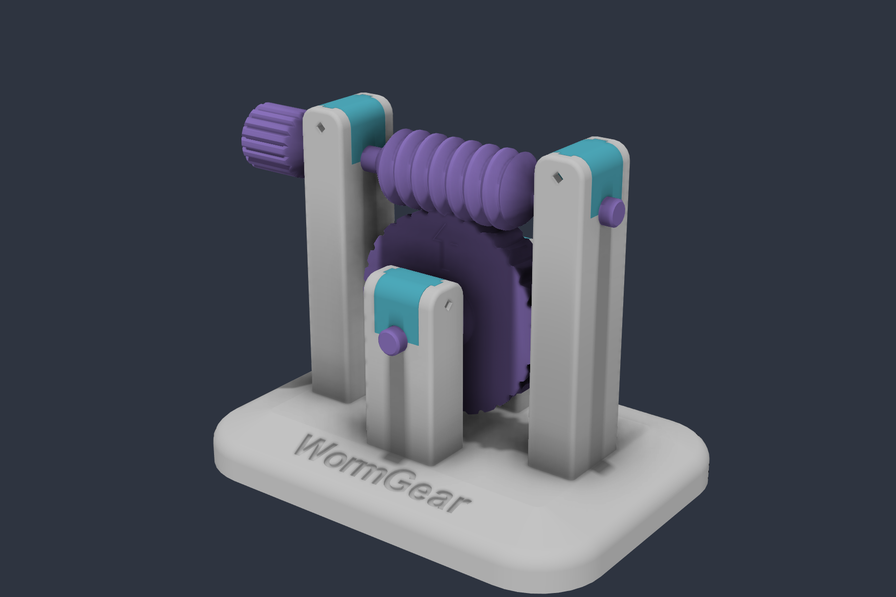
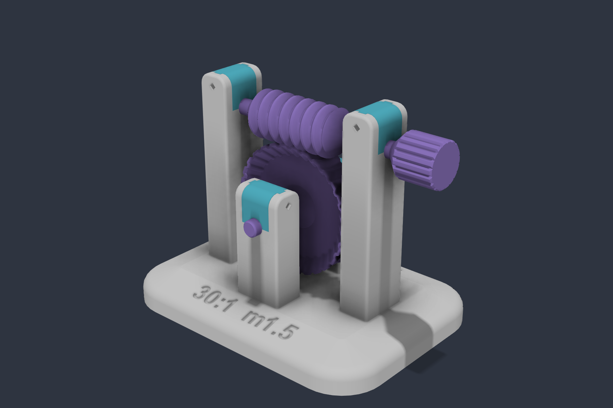
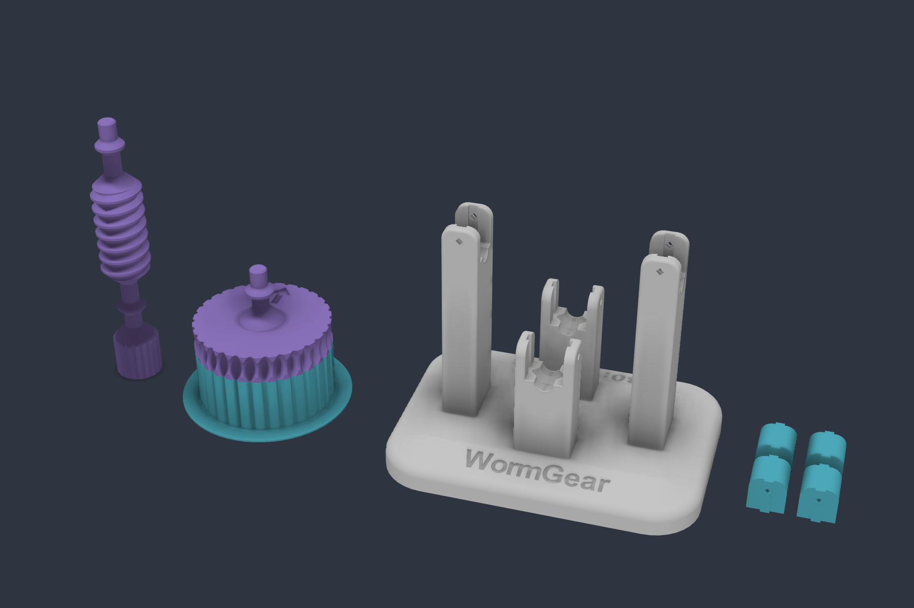
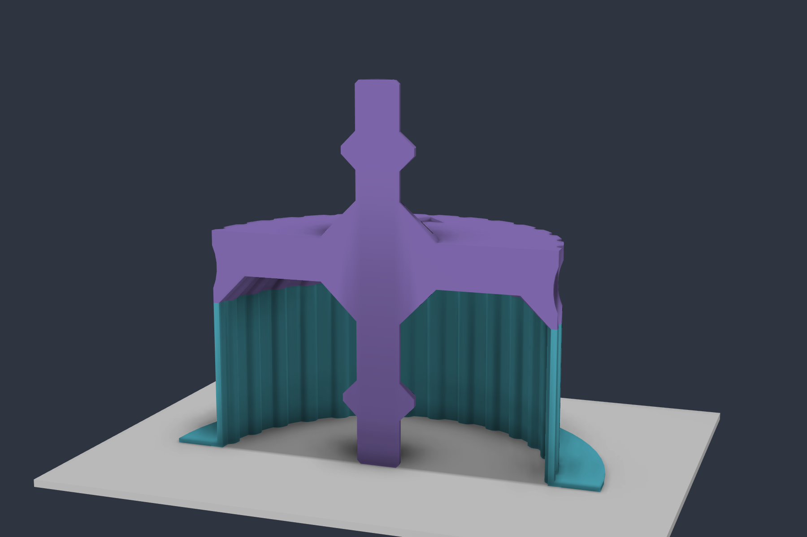

# ⚙️ WormGear demo

### A worm and its wheel to print, assemble and turn by hand

[Español](README.md) · **English** · [WormGear](../README.en.md)

Printable demo of WormGear's default gear set: module 1.5, 30-tooth wheel, single-start Ø16 worm with a 35 mm thread, and 45° flanks. Turn the knob and the wheel makes one turn for every 30 turns of the worm. The gear set is generated by [WormGear](../README.en.md).

The worm and the wheel are each printed **in one piece with their shafts**, which turn in "bearings" made of two 45° cones. The caps slide down into the columns, guided by tongues, and a piece of filament locks them.

## 🧩 Parts

The STEP files in [`step/`](step/) are already in their printing orientation, with the bed at z = 0. They need no slicer supports.

| File | Qty | How to print |
|---|---|---|
| [`base.step`](step/base.step) | 1 | Plate on the bed. |
| [`tapa.step`](step/tapa.step) (cap) | 4 | As mounted. The four caps are identical. |
| [`sinfin.step`](step/sinfin.step) (worm) | 1 | Standing, knob down. |
| [`rueda.step`](step/rueda.step) + [`soporte_rueda.step`](step/soporte_rueda.step) (wheel + support) | 1 | Standing on the tip of the shaft on the recessed side, with its support. Load both files together as one object: they are already in place. |
| 1.75 mm filament | 4 | 19 mm pins. |

[`conjunto.step`](step/conjunto.step) is the assembled demo, without the support.

## 🛞 The wheel support

The wheel is printed standing on the tip of its lower shaft, so the wheel sits 20 mm above the bed. To hold it up:

- **Recess:** the lower face of the wheel has a recess that rises at 45°, 4 mm inwards. That way almost the whole face prints without bridges.
- **Ring:** outside the recess only a 0.8 mm ring is left, following the outline of the teeth.
- **Support:** it is that same ring extruded down to the bed, with a 6 mm flange on the bed. Its section is an L: the wall holds the ring and the flange acts as a brim, so the part does not move.

## 🔧 Assembly

1. Rest the wheel and worm shafts in the half housings of the columns. The double cone of each shaft drops into its seat.
2. Slide each cap into its column from the top, with the tongues in the grooves, until it is all the way down.
3. Lock each cap with a piece of 1.75 mm filament through the column and the cap.

The mating parts have 0.1 mm of clearance per side.

## 🛠️ The Fusion script

[`fusion/WormGearDemo/`](fusion/WormGearDemo/) builds the whole demo in the active design. Run it from **Utilities › Add-Ins › Scripts**. It uses the `wormgear` package in [`../fusion`](../fusion/), so you need the whole repository.

- **Worm and wheel:** they come from WormGear.
- **Other parts:** the base, caps, shafts, recess, engravings and support are regular timeline features, so you can edit them afterwards.
- **Dimensions:** they are constants at the top of the script. The fillets are user parameters: `redondeo_placa`, `redondeo_chaflan`, `redondeo_columnas` and `redondeo_brazos`.
- **Assembly:** the script creates the joints and a motion link. Drag the worm and the wheel turns.

## 💡 Note

The trick of printing the wheel in one piece with its shaft comes from the video by **Iker Libano (KNIN Custom)** [*La Sorprendente Ingeniería Detrás de los Engranajes Impresos en 3D*](https://www.youtube.com/watch?v=5GPN3j80qZo&t=307s) (in Spanish).
