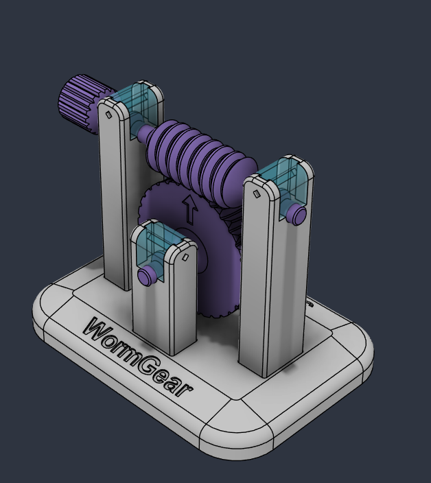
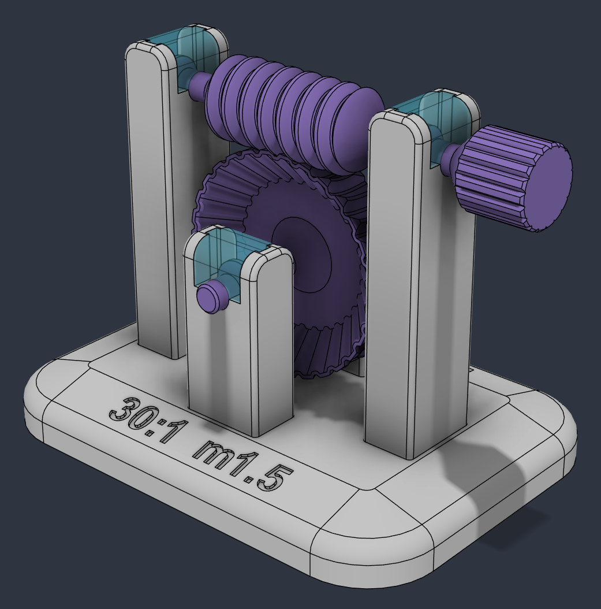
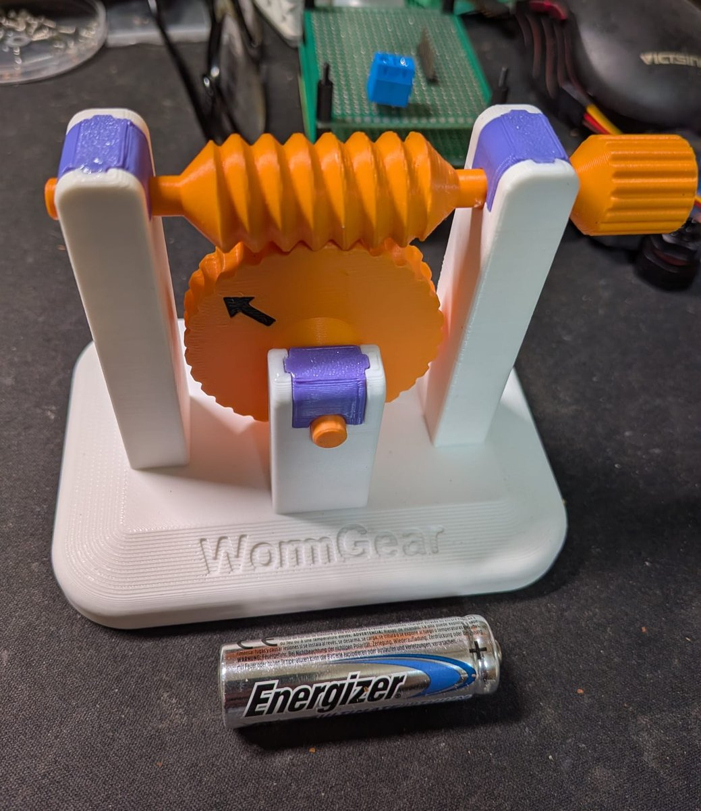
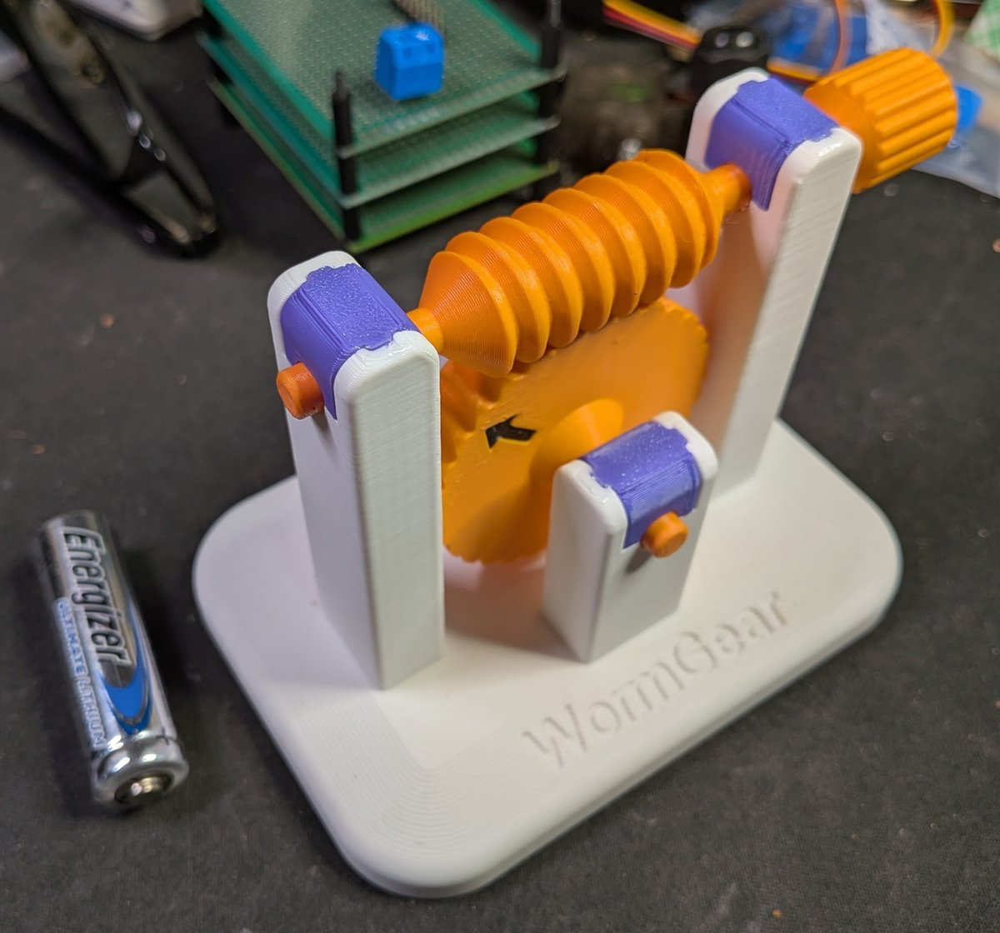
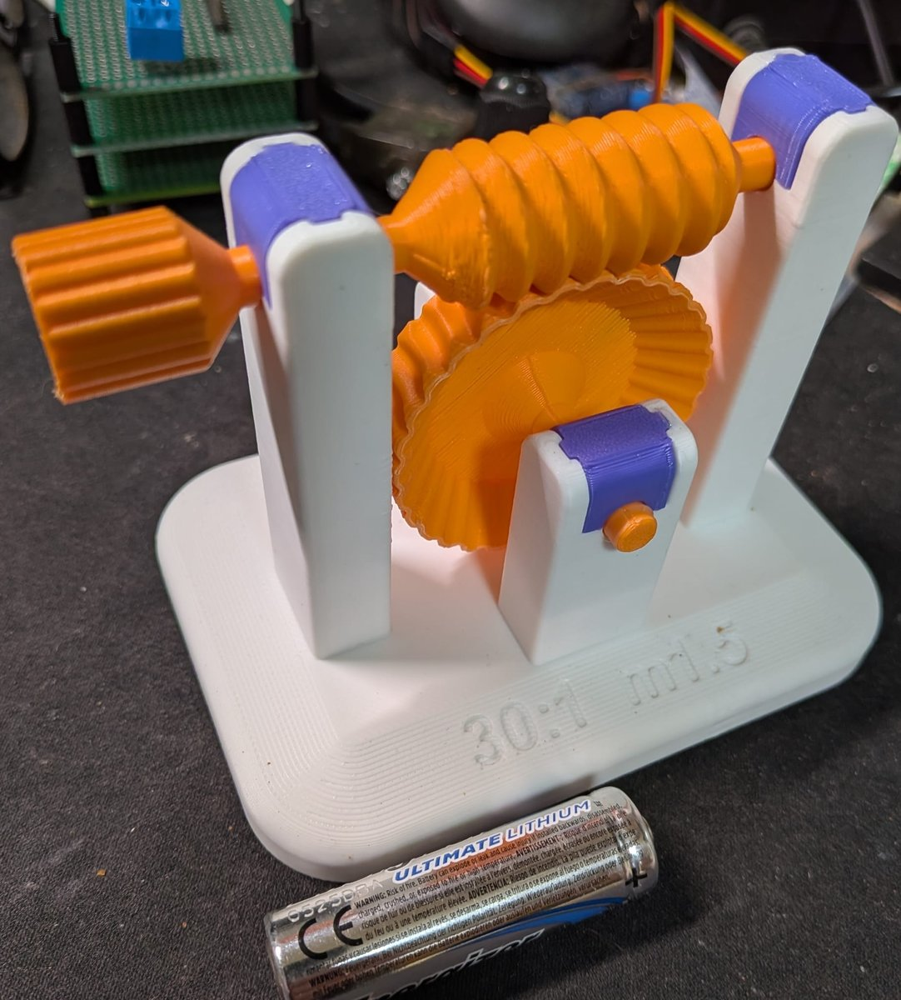
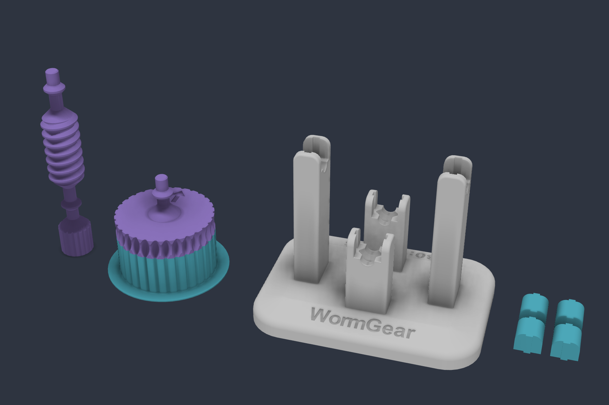
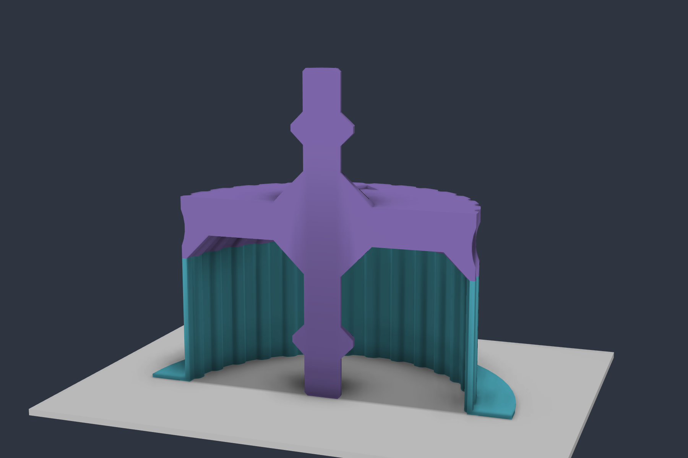

# ⚙️ Demo de WormGear

### Un sinfín y su rueda para imprimir, montar y girar con la mano

**Español** · [English](README.en.md) · [WormGear](../README.md)

Demo imprimible del engrane por defecto de WormGear: módulo 1.5, rueda de 30 dientes, sinfín de una entrada y Ø16 con 35 mm de filete, y flanco de 45°. Giras el pomo y la rueda da una vuelta cada 30 del sinfín. El engrane lo genera [WormGear](../README.md).

El sinfín y la rueda se imprimen **de una sola pieza con sus ejes**, que giran en "rodamientos" de dos conos de 45°. Las tapas entran en las columnas de arriba abajo, guiadas por unas lengüetas.

## 📷 Impresa

| | | |
|---|---|---|
|  |  |  |

## 🧩 Piezas

Los STEP de [`3d files/`](3d%20files/) ya están en su postura de impresión, con la cama en z = 0. No necesitan soportes del laminador.

| Archivo | Cantidad | Cómo se imprime |
|---|---|---|
| [`base.step`](3d%20files/base.step) | 1 | Con la placa en la cama. |
| [`tapa.step`](3d%20files/tapa.step) | 4 | Como va montada. Las cuatro tapas son iguales. |
| [`sinfin.step`](3d%20files/sinfin.step) | 1 | De pie, con el pomo abajo. |
| [`rueda.step`](3d%20files/rueda.step) | 1 | De pie, sobre la punta del eje del lado del rebaje. El archivo lleva la rueda y su soporte, ya en su sitio. Para quitar el soporte, sujeta la rueda y tira de él con unos alicates, sin hacer fuerza sobre el eje. |

[`conjunto.step`](3d%20files/conjunto.step) es la demo montada, sin el soporte.

[`WormGear.3mf`](3d%20files/WormGear.3mf) es el proyecto de Bambu Studio con todas las piezas en una sola placa. Está preparado para una Bambu Lab P1S con boquilla de 0.4, PLA y capas de 0.2 mm. [`WormGear.f3d`](3d%20files/WormGear.f3d) es el diseño de Fusion.

## 🛞 El soporte de la rueda

La rueda se imprime de pie sobre la punta de su eje de abajo, así que la rueda queda 20 mm por encima de la cama. Para que se sostenga:

- **Rebaje:** la cara de abajo de la rueda lleva un rebaje que sube a 45°, 4 mm hacia dentro. Así casi toda la cara se imprime sin puentes.
- **Anillo:** del rebaje solo queda fuera un anillo de 0.8 mm que sigue el contorno de los dientes.
- **Soporte:** es ese mismo anillo, extruido hasta la cama, con un ala de 6 mm en la cama. En sección tiene forma de L: la pared sostiene el anillo y el ala hace de brim, para que la pieza no se mueva.

## 🔧 Montaje

1. Apoya los ejes de la rueda y del sinfín en los medios alojamientos de las columnas. El doble cono de cada eje cae en su hueco.
2. Mete cada tapa en su columna desde arriba, con las lengüetas en las ranuras, hasta que baje del todo, y fíjala con una gota de pegamento (Loctite).

Las piezas que encajan tienen 0.1 mm de holgura por lado.

- **Grasa:** conviene poner un poco en los "rodamientos" de los ejes.
- **Si el eje frena:** si al bajar la tapa el eje deja de girar suave, lija un poco con papel de lija el diámetro exterior del doble cono del eje.

## 🛠️ El script de Fusion

[`fusion/WormGearDemo/`](fusion/WormGearDemo/) genera toda la demo en el diseño activo. Se lanza desde **Utilidades › Complementos › Scripts** y usa el `wormgear` de [`../fusion`](../fusion/), así que hay que tener el repositorio entero.

- **Sinfín y rueda:** salen de WormGear.
- **Resto de piezas:** la base, las tapas, los ejes, el rebaje, los grabados y el soporte son operaciones normales de la línea de tiempo, así que se pueden editar después.
- **Medidas:** están en constantes al principio del script. Los redondeos son parámetros de usuario: `redondeo_placa`, `redondeo_chaflan`, `redondeo_columnas` y `redondeo_brazos`.
- **Montaje:** crea las juntas y un enlace de movimiento. Si arrastras el sinfín, gira la rueda.

## 💡 Nota

El truco de imprimir la rueda de una sola pieza con su eje lo hemos sacado del vídeo de **Iker Libano** ([KNIN Custom](https://www.youtube.com/@KNIN_Custom)) [*La Sorprendente Ingeniería Detrás de los Engranajes Impresos en 3D*](https://www.youtube.com/watch?v=5GPN3j80qZo&t=307s).
