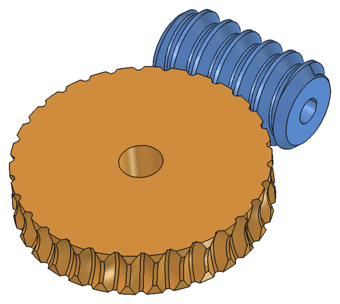
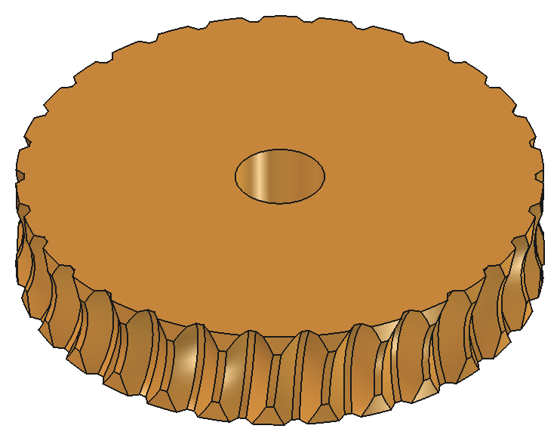
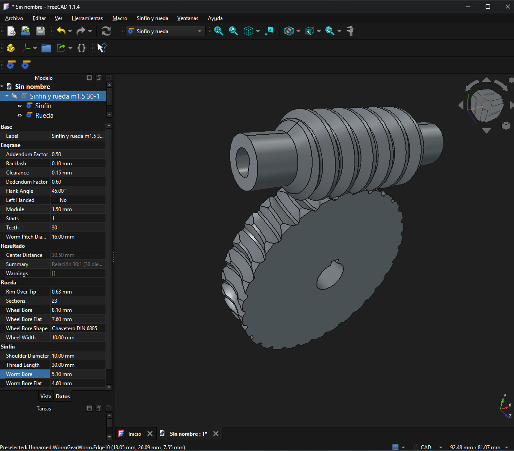

# Worm and wheel (FreeCAD workbench)

[Español](README.md) · **English**

Generates a worm and its smooth worm wheel, parametric and designed to print without supports. It is the FreeCAD version of [WormGear](../README.en.md): it uses the same math as the [Fusion add-in](../fusion/README.en.md) and gives the same result.

The FreeCAD gear module (FCGear) only makes the worm: the wheel has to be drawn by hand. Here you also get the wheel, with its teeth cut by the exact envelope of the worm.

| Assembly | Wheel (about 6 smooth faces per tooth) |
|---|---|
|  |  |

## Installation

FreeCAD 1.0 or later is needed. Tested with FreeCAD 1.1.4 on Windows.

FreeCAD loads the whole repo as an addon: it reads the `package.xml` in the root and takes the workbench from this folder. There are three ways to install it.

**With the Addon Manager:**
1. In **Edit > Preferences > Addon Manager**, add a custom repository with the URL `https://github.com/buho29/wormgear` and the branch `main`.
2. In **Tools > Addon Manager**, search for *WormGear* and install it.

That way it also updates from the manager.

**By hand:** download the repo (**Code > Download ZIP** on GitHub), unzip it and copy the whole folder, named `WormGear`, into the FreeCAD user `Mod` folder:
- on Windows with FreeCAD 1.1, `%APPDATA%\FreeCAD\v1-1\Mod`;
- on Windows with FreeCAD 1.0, `%APPDATA%\FreeCAD\Mod`;
- on Linux and Mac, the FreeCAD Python console tells you where the user folder is: `App.getUserAppDataDir()`; `Mod` goes inside.

**With the repo (development):**

```powershell
powershell -ExecutionPolicy Bypass -File freecad\install.ps1
```

The script creates a link (junction) `Mod\WormGear` to the root of the repo, which is the same thing the Addon Manager leaves.

Then restart FreeCAD and choose the **Worm and wheel** workbench in the workbench list.

If you change the code, restart FreeCAD.

## Use

First steps:
1. Choose **Worm and wheel** in the workbench drop-down of the toolbar (or in **View > Workbench**).
2. Create a document with **File > New** (Ctrl+N).
3. Press the **Worm and wheel** button.
4. Select "Worm and wheel …" in the tree and change its values in the *Data* tab of the property view.



The workbench has two buttons:

- **Worm and wheel** creates three objects in the active document:
  - "Worm and wheel …", hidden, with all the parameters. This is the one you edit: change a value in the property view and it recomputes.
  - "Worm" and "Wheel", inside the previous one in the tree. These are the parts: they can be moved, colored and exported to STL separately.
- **Check mesh** (with the worm, the wheel or the parameter object selected) runs the [check](../README.en.md#-mesh-check): interference at 8 positions and backlash measured on each side. It takes a couple of minutes and can be cancelled.

The wheel takes about 15 seconds to generate (30 teeth). If you only change the length or the bore of the worm, the previous wheel is reused and it is almost instant.

**How to print it:** the worm standing and the wheel lying flat.

## Properties

The parameters are the same as in Fusion. They are on the [front page](../README.en.md#-parameters), with their defaults and the name of each property.

The property names are in English because they are FreeCAD identifiers. The groups, the description shown when hovering, the buttons, the warnings and the part names are in Spanish if FreeCAD is in Spanish (**Edit > Preferences > General > Language**, or the system language), and in English for any other language. A document saved in another language adapts when opened, without recomputing.

The bore shapes (`Worm Bore Shape`, `Wheel Bore Shape`) are chosen from a list. Documents made with the previous version open fine: the new properties are added with their default value.

The **Result** group also has three read-only properties:
- `Center Distance`: the center distance;
- `Summary`: the summary (ratio, center distance, lead angle, estimated efficiency and self-locking, diameters);
- `Warnings`: the warnings, the same as in the Fusion dialog. They also appear in the report view.

With an error (for example, a wheel too wide for the worm) the object is marked in red and is not generated.

## How it is built

The wheel is computed as in the Fusion add-in. It is explained, with diagrams, on the front page: [How the wheel is computed](../README.en.md#-how-the-wheel-is-computed). In short:
1. It is cut with planes parallel to the mid-plane of the wheel.
2. In each plane, the worm is a rack.
3. A closed formula gives the profile of the tooth gap (`geometry.gap_profile`).
4. A loft joins the profiles, and the gap is repeated and subtracted from the disc.

`freecad/wormgear/geometry.py` is an exact copy of the Fusion one, and so is `i18n.py` (the English texts). If one changes, both must change: the tests warn if they differ and if a translation is missing.

What changes is the construction, which in FreeCAD is done with OCCT:
- **The worm** is a single transverse section (core and threads) extruded along a helix, as FCGear does, instead of the sweep of the axial profile used in Fusion. It is the same worm: a straight flank in the axial section is an Archimedean spiral in the transverse one.
- **Two OCCT traps**, which fail silently (the boolean returns one of the two solids whole):
  - with the defaults, the helical extrusion comes out with degree-10 faces and the cuts with cones fail. The degree is limited to 5.
  - if the chamfer cone passes exactly through the core edge at the end, it fails for one in four lengths. That is why the chamfer starts 0.3 mm below the thread root.

  The volume of the result is also checked, to give an error instead of a bad part.
- **The bores** are a prism of the outline (round, D, hexagonal, square or keyway) subtracted at the end.
- **Left-handed**, the worm is mirrored at the end; the wheel already comes out mirrored from the profiles.
- There are no joints: FreeCAD has no motion links like Fusion.

## Tests

```powershell
& "C:\Program Files\FreeCAD 1.1\bin\freecadcmd.exe" freecad\tests\run_tests.py
```

It generates and checks four sets (about 12 minutes in total), one of them left-handed, with plain ends and hexagonal and D bores. With the `WORMGEAR_OUT` variable it also leaves the STLs in that folder. The results with FreeCAD 1.1.4 are on the [front page](../README.en.md#-mesh-check): 0 mm³ of interference and a measured backlash of 0.100 to 0.104 mm (requested 0.100 mm) in all four.

## Files

- `freecad/wormgear/init_gui.py`: registers the workbench.
- `freecad/wormgear/commands.py`: the two buttons.
- `freecad/wormgear/features.py`: the parametric objects and their properties.
- `freecad/wormgear/shapes.py`: creates the solids with Part. It does not need the GUI.
- `freecad/wormgear/check.py`: checks interference and backlash.
- `freecad/wormgear/geometry.py`: the math, a copy of the Fusion add-in's.
- `freecad/wormgear/i18n.py`: the English texts, a copy of the Fusion one.
- `freecad/wormgear/resources/`: the icons.
- `tests/run_tests.py`: the tests without GUI.
- `install.ps1`: creates the link in the `Mod` folder.
- `../package.xml`: the metadata for the Addon Manager. It tells FreeCAD that the workbench is in this folder.
- `img/`: the images of this README, made with FreeCAD (`banco.png` is a screenshot of the interface). The diagrams of the calculation are in the root [`img/`](../img/).
