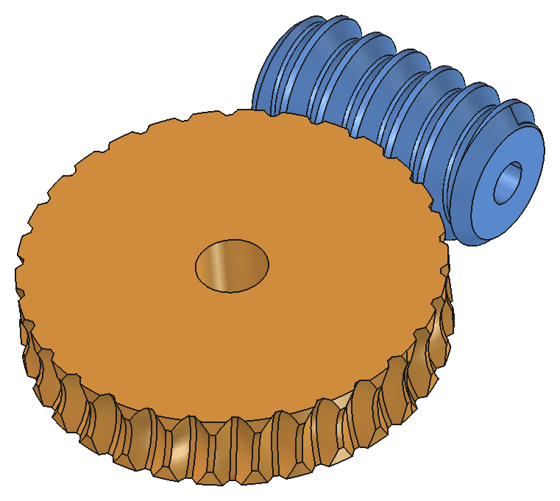
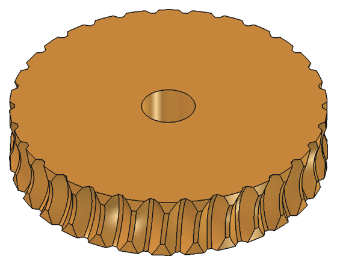

# Sinfín y rueda (banco de trabajo de FreeCAD)

Genera un tornillo sin fin y su rueda dentada lisa, paramétricos y pensados para imprimir sin soportes. Es la versión para FreeCAD de [WormGear](../README.md): usa la misma matemática que el [add-in de Fusion](../fusion/README.md) y da el mismo resultado.

El módulo de engranajes de FreeCAD (FCGear) solo hace el sinfín: la rueda hay que dibujarla a mano. Aquí sale también la rueda, con los dientes tallados por la envolvente exacta del sinfín.

| Conjunto | Rueda (unas 6 caras lisas por diente) |
|---|---|
|  |  |

## Instalación

Hace falta FreeCAD 1.0 o posterior. Probado con FreeCAD 1.1.4 en Windows.

FreeCAD carga el repo entero como un complemento: lee el `package.xml` de la raíz y saca el banco de esta carpeta. Hay tres formas de instalarlo.

**Con el gestor de complementos:**
1. En **Editar > Preferencias > Gestor de complementos**, añade un repositorio personalizado con la URL `https://github.com/buho29/wormgear` y la rama `main`.
2. En **Herramientas > Gestor de complementos**, busca *WormGear* e instálalo.

Así también se actualiza desde el gestor.

**A mano:** descarga el repo (**Code > Download ZIP** en GitHub), descomprímelo y copia la carpeta entera, con el nombre `WormGear`, en la carpeta `Mod` del usuario de FreeCAD:
- en Windows con FreeCAD 1.1, `%APPDATA%\FreeCAD\v1-1\Mod`;
- en Windows con FreeCAD 1.0, `%APPDATA%\FreeCAD\Mod`;
- en Linux y Mac, la consola de Python de FreeCAD dice dónde está la carpeta de usuario: `App.getUserAppDataDir()`; `Mod` va dentro.

**Con el repo (desarrollo):**

```powershell
powershell -ExecutionPolicy Bypass -File freecad\install.ps1
```

El script crea un enlace (junction) `Mod\WormGear` hasta la raíz del repo, que es lo mismo que deja el gestor de complementos.

Después, reinicia FreeCAD y elige el banco de trabajo **Sinfín y rueda** en la lista de bancos.

Si cambias el código, reinicia FreeCAD.

## Uso

El banco tiene dos botones:

- **Sinfín y rueda** crea tres objetos en el documento activo:
  - "Sinfín y rueda …", oculto, con todos los parámetros. Es el que se edita: cambias un valor en el panel de propiedades y se recalcula.
  - "Sinfín" y "Rueda", dentro del anterior en el árbol. Son las piezas: se pueden mover, colorear y exportar a STL por separado.
- **Comprobar engrane** (con el sinfín, la rueda o el objeto de parámetros seleccionado) hace la [comprobación](../README.md#-comprobación-del-engrane): interferencia en 8 posiciones y juego medido por cada lado. Tarda un par de minutos y se puede cancelar.

La rueda tarda unos 15 segundos en generarse (30 dientes). Si solo cambias la longitud o el taladro del sinfín, se reutiliza la rueda anterior y es casi instantáneo.

**Cómo imprimirlo:** el sinfín de pie y la rueda tumbada.

## Propiedades

Los parámetros son los mismos que en Fusion. Están, con sus valores por defecto y el nombre de cada propiedad, en la [portada](../README.md#-parámetros).

Los nombres de las propiedades van en inglés porque son identificadores de FreeCAD. Al pasar el ratón por encima sale la descripción en castellano.

Además, el grupo **Resultado** tiene tres propiedades de solo lectura:
- `Center Distance`: la distancia entre ejes;
- `Summary`: el resumen (relación, distancia entre ejes, ángulo de hélice y autobloqueo, diámetros);
- `Warnings`: los avisos, los mismos que en el diálogo de Fusion. También salen en la vista de informe.

Con un error (por ejemplo, una rueda demasiado ancha para el sinfín) el objeto queda marcado en rojo y no se genera.

## Cómo se construye

La rueda se calcula igual que en el add-in de Fusion. Está explicado, con diagramas, en la portada: [Cómo se calcula la rueda](../README.md#-cómo-se-calcula-la-rueda). En resumen:
1. Se corta con planos paralelos al plano medio de la rueda.
2. En cada plano, el sinfín es una cremallera.
3. Con una fórmula cerrada sale el perfil del hueco del diente (`geometry.gap_profile`).
4. Una solevación une los perfiles, y el hueco se repite y se resta del disco.

`freecad/wormgear/geometry.py` es una copia exacta del de Fusion. Si se cambia, hay que cambiar los dos: las pruebas avisan si no son iguales.

Lo que cambia es la construcción, que en FreeCAD se hace con OCCT:
- **El sinfín** es una sola sección transversal (núcleo y filetes) extruida en hélice, como hace FCGear, en vez del barrido del perfil axial que se usa en Fusion. Es el mismo sinfín: un flanco recto en la sección axial es una espiral de Arquímedes en la transversal.
- **Dos trampas de OCCT**, que fallan sin avisar (el booleano devuelve uno de los dos sólidos entero):
  - con los valores por defecto, la extrusión en hélice sale con caras de grado 10 y los cortes con conos fallan. Se limita el grado a 5.
  - si el cono del chaflán pasa justo por la arista del núcleo en el extremo, falla en uno de cada cuatro largos. Por eso el chaflán empieza 0.3 mm por debajo del fondo del filete.

  Además se comprueba el volumen del resultado, para dar un error en vez de una pieza mal hecha.
- No hay juntas: FreeCAD no tiene enlaces de movimiento como Fusion.

## Pruebas

```powershell
& "C:\Program Files\FreeCAD 1.1\bin\freecadcmd.exe" freecad\tests\run_tests.py
```

Genera y comprueba tres juegos (unos 10 minutos en total). Con la variable `WORMGEAR_OUT` deja además los STL en esa carpeta. Los resultados con FreeCAD 1.1.4 están en la [portada](../README.md#-comprobación-del-engrane): 0 mm³ de interferencia y un juego medido de 0.101 a 0.104 mm (pedido 0.100 mm) en los tres.

## Archivos

- `freecad/wormgear/init_gui.py`: registra el banco de trabajo.
- `freecad/wormgear/commands.py`: los dos botones.
- `freecad/wormgear/features.py`: los objetos paramétricos y sus propiedades.
- `freecad/wormgear/shapes.py`: crea los sólidos con Part. No necesita la interfaz.
- `freecad/wormgear/check.py`: comprueba interferencias y juego.
- `freecad/wormgear/geometry.py`: la matemática, copia de la del add-in de Fusion.
- `freecad/wormgear/resources/`: los iconos.
- `tests/run_tests.py`: las pruebas sin interfaz.
- `install.ps1`: crea el enlace en la carpeta `Mod`.
- `../package.xml`: los metadatos para el gestor de complementos. Le dice a FreeCAD que el banco está en esta carpeta.
- `img/`: las imágenes de este README, sacadas con FreeCAD. Los diagramas del cálculo están en el [`img/`](../img/) de la raíz.
