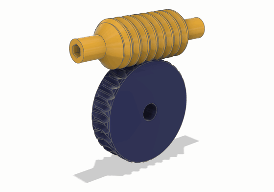
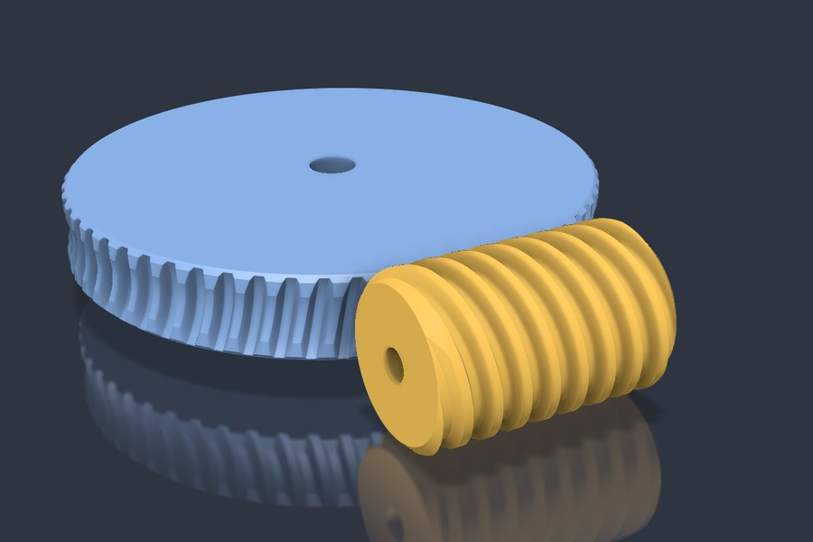
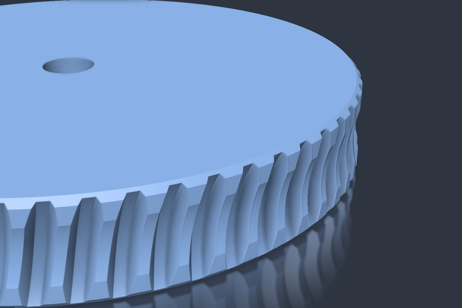
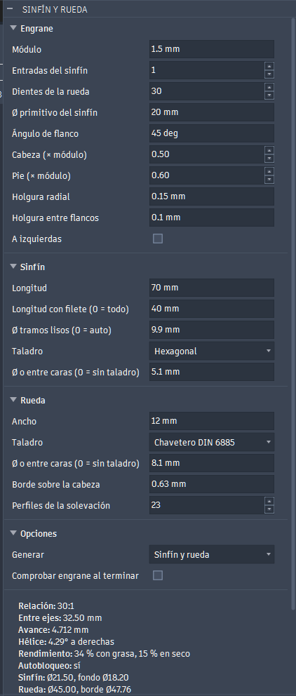
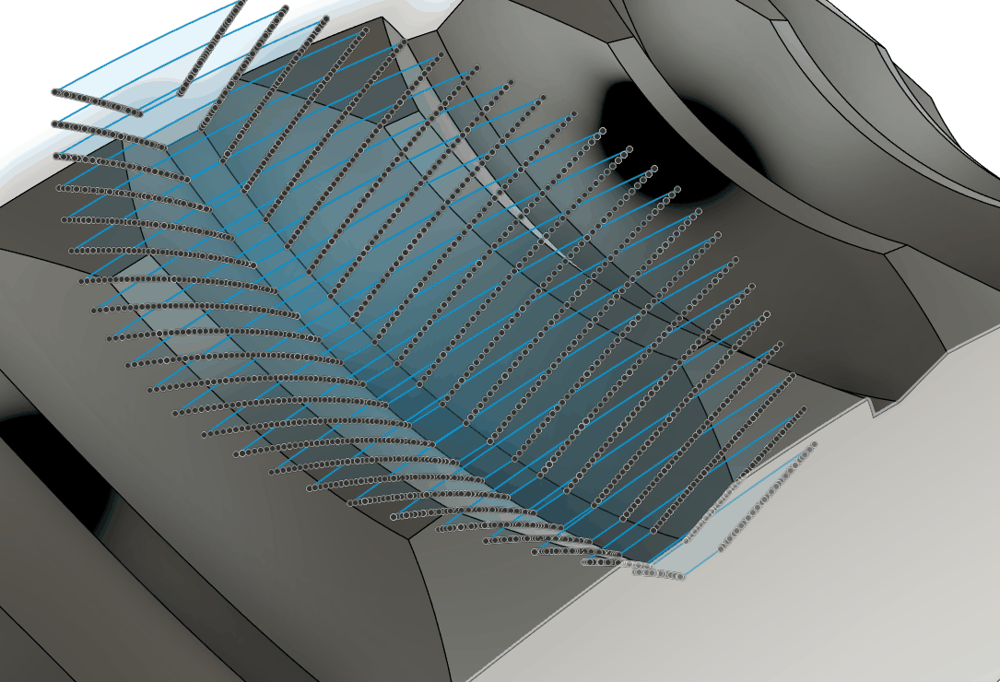
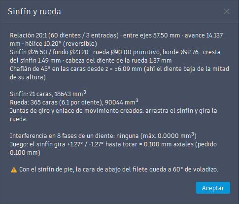

# Worm and wheel (Fusion 360 add-in)

[Español](README.md) · **English**

Generates a worm and its worm wheel, parametric and designed to print without supports.

It is in **SOLID > CREATE > Worm and wheel** (part and hybrid designs) and in **ASSEMBLE > CREATE** (assembly designs).

It is part of [WormGear](../README.en.md), which also has a [FreeCAD version](../freecad/README.en.md) with the same math. The front page has what both share: the [parameters](../README.en.md#-parameters), the [mesh check](../README.en.md#-mesh-check) and [how the wheel is computed](../README.en.md#-how-the-wheel-is-computed), with diagrams.



The animation is of a set generated with the add-in: module 1.5, 30 teeth and a 1-start worm (30:1 ratio), with plain ends and a hexagonal bore in the worm. One turn of the worm moves the wheel by one tooth. The images below are of another set: 60 teeth, 3-start worm (20:1 ratio) and a 30° flank.

| Assembly | Wheel teeth (smooth, from the loft) |
|---|---|
|  |  |

## Installation

### Without the repo (zip)

1. Download `WormGear-<version>.zip` from the [Releases](https://github.com/buho29/wormgear/releases) and unzip all of it.
2. Double-click `instalar.bat`. It copies the `WormGear` folder into the Fusion add-ins folder and does not ask for administrator rights.
3. In Fusion: **UTILITIES > ADD-INS** (Shift+S) > *WormGear* > **Run**, and tick *Run on Startup*.

To update, run the `instalar.bat` of the new version: the last dialog values are kept. To remove it, use `desinstalar.bat`. Do not use them on a computer with the development install from `install.ps1`: you would get the add-in twice.

On a Mac, copy the `WormGear` folder from the zip by hand to `~/Library/Application Support/Autodesk/Autodesk Fusion 360/API/AddIns/`.

**To make a new version:**
1. Raise `version` in `WormGear.manifest`.
2. Run `powershell -ExecutionPolicy Bypass -File fusion\installer\make_release.ps1`. It leaves the zip in `dist/`, which is not in git.
3. Upload the zip to a GitHub Release.

### With the repo (development)

```powershell
powershell -ExecutionPolicy Bypass -File fusion\install.ps1
```

Close Fusion first. The script points the Fusion add-ins list at this folder, like the **+** button of the add-ins dialog, and ticks *Run on Startup*. Fusion loads the code straight from the repo and starts the add-in when it opens.

No link (junction) is used in `%APPDATA%\Autodesk\Autodesk Fusion 360\API\AddIns`: Fusion follows it to the repo and the add-in shows up twice. If one is left from an earlier install, the script removes it.

If you change the code, stop the add-in and run it again.

## The dialog



The screenshot is of the dialog in Spanish. The parameters and their defaults are on the [front page](../README.en.md#-parameters).

The summary, below the options, updates as you type. It has one line per value:
- the gear ratio;
- the center distance;
- the lead;
- the lead angle;
- the estimated efficiency, greased and dry;
- whether the worm self-locks: yes, dry only or no;
- the worm and wheel diameters;
- the worm crest and the tooth tip;
- the thread and plain ends, and the face chamfer, if there are any.

Below it come the errors and the warnings: thin worm crest, throat past 45°, overhangs, undercut, pointed teeth and thin hub.

With an error it will not generate.

The dialog, the summary, the messages and the timeline names are in Spanish if Fusion is in Spanish, and in English for any other language (**Preferences > General > Language**; Fusion asks to restart).

The last values are saved in `settings.json`, which is not in git.

## What it creates

- **In an assembly or hybrid design:** three components:
  - "Worm …" and "Wheel …";
  - "Axes …", grounded, with the lines of both axes.

  Each part has a revolute joint about its axis, and the two are tied by a *motion link* with the ratio: drag the worm and the wheel turns.
- **In a part design:** two bodies, without joints.

Everything goes into one timeline group and is undone with a single Ctrl+Z.

**How to print it:** the worm standing and the wheel lying flat.

## How it is built

The wheel calculation is the shared one, explained on the [front page](../README.en.md#-how-the-wheel-is-computed). In Fusion:
- **the worm** is a sweep of the axial profile along a helix;
- **the wheel** is made with one sketch per plane with two splines and two arcs, a loft, a circular pattern, the cut of the disc with its toroidal throat, and the chamfer;
- **the bores** are a sketch and a cut extrusion at the end of each part: they can be edited in the timeline;
- **left-handed**, the motion link is reversed.



The sketches of one tooth gap, one per plane, with the points of their splines, and the loft that joins them (in blue). It is then repeated with the circular pattern and subtracted from the disc.

## Mesh check

The **Check mesh** checkbox of the dialog runs the [check](../README.en.md#-mesh-check) with temporary bodies: interference at 8 positions and backlash measured on each side. With the defaults it gives 0 mm³ and ±3.8°, which is 0.100 mm axial: exactly the requested clearance.

When it finishes, the result is shown in a message. This is the one for the set in the images (in Spanish):



## Files

- `WormGear.py`: the add-in (button, dialog and events).
- `wormgear/geometry.py`: the math. It does not depend on Fusion: `python -X utf8 wormgear/geometry.py` prints a test summary.
- `wormgear/i18n.py`: the English texts. `python -X utf8 wormgear/i18n.py` checks that none is missing.
- `wormgear/build.py`: creates the geometry in the active design.
- `wormgear/check.py`: checks interference and backlash.
- `resources/`: the icons.
- `img/`: the images of this README. The GIFs were made from the Fusion MCP: the bodies and their edges are copied as custom graphics (meshes and lines), turned with the ratio, and one frame is saved per position. The vertices are rotated, not the graphic's transform: that way the bounding box does not grow and the ground, with its shadow, does not move. In `seccion.gif`, the cut is an intersection with a box in every frame, with temporary bodies. The diagrams of the calculation are in the root [`img/`](../img/).
- `install.ps1`: registers this folder in the Fusion add-ins list.
- `installer/`: `instalar.bat`, `desinstalar.bat`, `LEEME.txt` and `README.txt` (English), which go in the zip, and `make_release.ps1`, which builds it.
