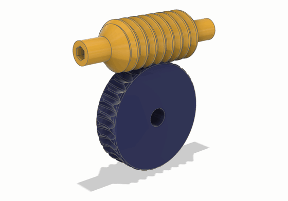
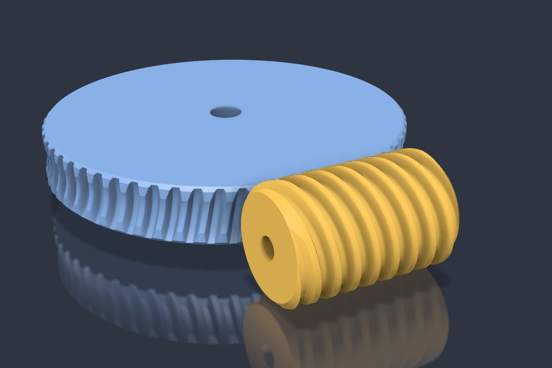
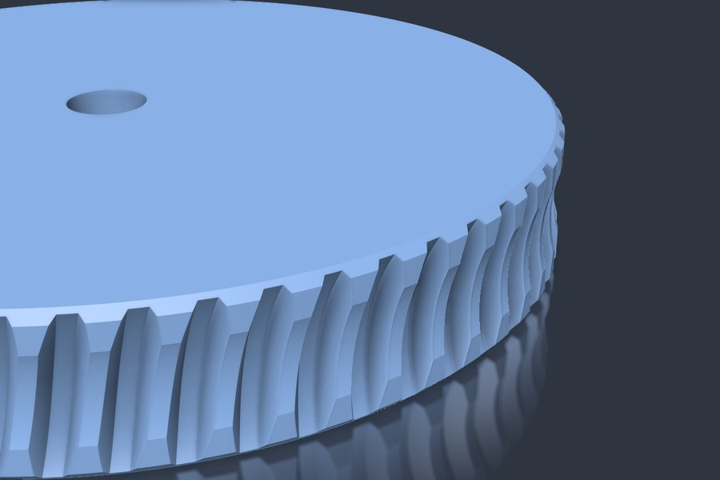
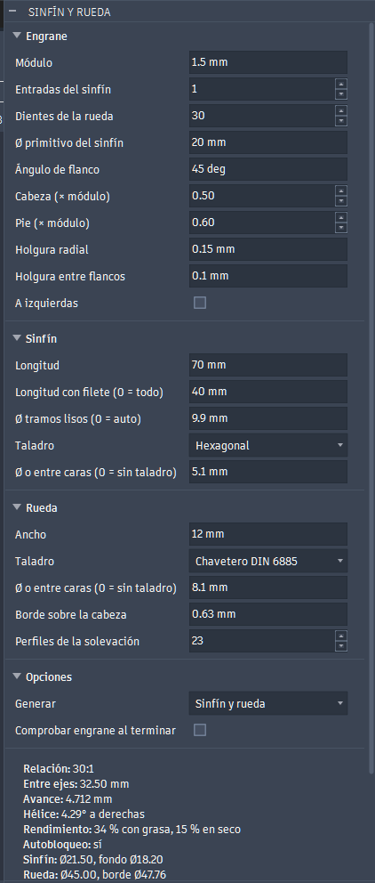
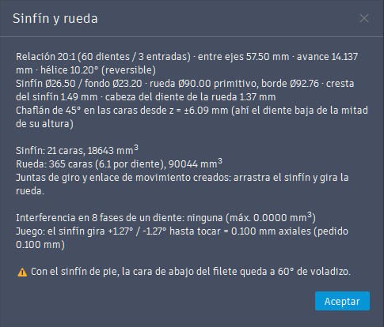

# Sinfín y rueda (add-in de Fusion 360)

Genera un tornillo sin fin y su rueda dentada, paramétricos y pensados para imprimir sin soportes.

Está en **SÓLIDO > CREAR > Sinfín y rueda** (diseños de pieza e híbridos) y en **ENSAMBLAJE > CREAR** (diseños de ensamblaje).

Es parte de [WormGear](../README.md), que también tiene una [versión para FreeCAD](../freecad/README.md) con la misma matemática. En la portada están lo común a las dos: los [parámetros](../README.md#-parámetros), la [comprobación](../README.md#-comprobación-del-engrane) y [cómo se calcula la rueda](../README.md#-cómo-se-calcula-la-rueda), con diagramas.



Las imágenes son de un juego generado con el add-in: módulo 1.5, 60 dientes, sinfín de 3 entradas (relación 20:1) y flanco de 30°. En la animación, una vuelta del sinfín hace girar la rueda 3 dientes.

| Conjunto | Dientes de la rueda (lisos, de la solevación) |
|---|---|
|  |  |

## Instalación

### Sin el repo (zip)

1. Descarga `WormGear-<versión>.zip` de las [Releases](https://github.com/buho29/wormgear/releases) y descomprímelo entero.
2. Haz doble clic en `instalar.bat`. Copia la carpeta `WormGear` en la carpeta de complementos de Fusion y no pide permisos de administrador.
3. En Fusion: **Utilidades > Complementos** (Mayús+S) > *WormGear* > **Ejecutar**, y marca *Al iniciar*.

Para actualizar, ejecuta el `instalar.bat` de la versión nueva: se conservan los últimos valores del diálogo. Para quitarlo, usa `desinstalar.bat`. No los uses en un equipo con la instalación de desarrollo de `install.ps1`: tendrías el complemento dos veces.

En Mac, copia a mano la carpeta `WormGear` del zip a `~/Library/Application Support/Autodesk/Autodesk Fusion 360/API/AddIns/`.

**Para sacar una versión nueva:**
1. Sube `version` en `WormGear.manifest`.
2. Ejecuta `powershell -ExecutionPolicy Bypass -File fusion\installer\make_release.ps1`. Deja el zip en `dist/`, que no va en git.
3. Sube el zip a una Release de GitHub.

### Con el repo (desarrollo)

```powershell
powershell -ExecutionPolicy Bypass -File fusion\install.ps1
```

Cierra Fusion antes. El script apunta la lista de complementos de Fusion a esta carpeta, como el botón **+** del diálogo de complementos, y marca *Al iniciar*. Fusion carga directamente lo que hay en el repo y arranca el complemento al abrirse.

No se usa un enlace (junction) en `%APPDATA%\Autodesk\Autodesk Fusion 360\API\AddIns`: Fusion lo sigue hasta el repo y el complemento sale dos veces. Si queda uno de una instalación anterior, el script lo quita.

Si cambias el código, para el complemento y vuelve a ejecutarlo.

## El diálogo



Los parámetros y sus valores por defecto están en la [portada](../README.md#-parámetros).

El cuadro *Resumen* se actualiza mientras se teclea. Muestra:
- la relación de transmisión;
- la distancia entre ejes;
- el ángulo de hélice, y si el sinfín se autobloquea;
- los diámetros;
- los avisos: cresta del sinfín muy fina, garganta de más de 45°, voladizos, socavado, dientes en punta y poco cubo.

Con un error no deja generar.

Los últimos valores se guardan en `settings.json`, que no va en git.

## Qué crea

- **En un diseño de ensamblaje o híbrido:** tres componentes:
  - "Sinfín …" y "Rueda …";
  - "Ejes …", fijo, con las líneas de los dos ejes.

  Cada pieza tiene una junta de giro sobre su eje, y las dos van unidas por un *enlace de movimiento* con la relación: arrastras el sinfín y gira la rueda.
- **En un diseño de pieza:** dos cuerpos, sin juntas.

Todo queda en un grupo de la línea de tiempo y se deshace con un solo Ctrl+Z.

**Cómo imprimirlo:** el sinfín de pie y la rueda tumbada.

## Cómo se construye

El cálculo de la rueda es el común, explicado en la [portada](../README.md#-cómo-se-calcula-la-rueda). En Fusion:
- **el sinfín** es un barrido del perfil axial a lo largo de una hélice;
- **la rueda** se hace con un boceto por plano con dos splines y dos arcos, una solevación, un patrón circular, el corte del disco con su garganta toroidal y el chaflán;
- **los taladros** son un boceto y una extrusión de corte al final de cada pieza: se pueden editar en la línea de tiempo;
- **a izquierdas**, el enlace de movimiento va invertido.

## Comprobar engrane

La casilla **Comprobar engrane** del diálogo hace la [comprobación](../README.md#-comprobación-del-engrane) con cuerpos temporales: interferencia en 8 posiciones y juego medido por cada lado. Con los valores por defecto da 0 mm³ y ±3.8°, que son 0.100 mm axiales: justo la holgura pedida.

Al terminar, el resultado sale en un mensaje. Este es el del juego de las imágenes:



## Archivos

- `WormGear.py`: el add-in (botón, diálogo y eventos).
- `wormgear/geometry.py`: la matemática. No depende de Fusion: `python -X utf8 wormgear/geometry.py` imprime un resumen de prueba.
- `wormgear/build.py`: crea la geometría en el diseño activo.
- `wormgear/check.py`: comprueba interferencias y juego.
- `resources/`: los iconos.
- `img/`: las imágenes de este README. El GIF se hizo desde el MCP de Fusion: los cuerpos se copian como gráficos personalizados, se giran con la relación y se guarda un fotograma por posición. Los diagramas del cálculo están en el [`img/`](../img/) de la raíz.
- `install.ps1`: registra esta carpeta en la lista de complementos de Fusion.
- `installer/`: `instalar.bat`, `desinstalar.bat` y `LEEME.txt`, que van en el zip, y `make_release.ps1`, que lo genera.
